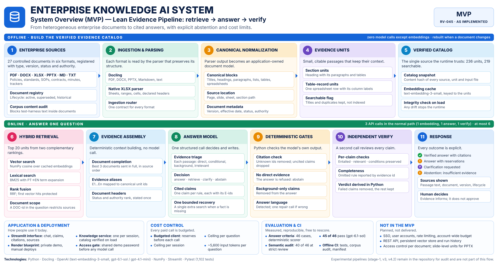

# Enterprise Knowledge AI System

🚀 **Current Stage:** Experimental End-to-End RAG & Structured Answers\
🧪 **Validation:** Retrieval/context through RV-014; answer contracts and live generation diagnostics RV-015/016\
📋 **Next Stage:** Bounded semantic orchestration — proposed, not implemented

The **Enterprise Knowledge AI System** is an Enterprise
Retrieval-Augmented Generation (RAG) system designed to transform
heterogeneous and fragmented corporate information into a trustworthy,
searchable, and evidence-grounded knowledge layer.

The project combines **multi-format ingestion, canonical normalization,
structure-aware chunking, semantic retrieval, enterprise metadata,
evidence traceability, governance, and systematic evaluation** to
support reliable AI-assisted access to organizational knowledge.

> **Evidence before generation. Retrieval quality before answer
> fluency.**

## Engineering Overview

The architecture separates **offline knowledge processing and indexing**
from **online retrieval and answer generation**. Enterprise documents
are parsed and normalized into a canonical representation, transformed
into structure-aware retrieval units, indexed for complementary
retrieval strategies, and used as controlled evidence for grounded
answers.

| Layer | Implementation / Direction |
|---|---|
| Enterprise Sources | PDF, DOCX, XLSX, PPTX, Markdown / Text |
| Parsing | Docling + specialized format parsers |
| Canonical Model | Structure-preserving document representation |
| Chunking | Structure-aware retrieval chunks |
| Search Text | Retrieval-oriented representation derived from chunks |
| Embeddings | OpenAI embeddings |
| Vector Retrieval | NumPy vector index + cosine similarity |
| Lexical Retrieval | BM25 with query filtering integrated into hybrid retrieval |
| Metadata Retrieval | Structured filters — target architecture |
| Fusion & Reranking | RRF + document diversity implemented; reranker experimental |
| Ground Truth | Canonical facts + document registry + golden questions |
| Generation | Real LLM integration with structured answers and abstention |
| Citation Validation | Structural checks implemented; semantic support under evaluation |
| Evaluation | Retrieval/context experiments; answer quality and governance evaluation in progress |
| Validation | Pytest + recorded real retrieval experiments |



The architecture overview represents the complete engineering direction
of the system. The **Current Status** section below distinguishes
implemented and validated capabilities from the remaining target
architecture.

## Trustworthy Enterprise RAG Principle

The system is designed around a simple responsibility chain:

``` text
Enterprise Knowledge
        ↓
Canonical Representation
        ↓
Structure-Aware Retrieval Units
        ↓
Search & Retrieval
        ↓
Evidence Ranking
        ↓
Controlled Context
        ↓
Grounded Generation
        ↓
Citations / Abstention
```

The central rule is:

> **Retrieve evidence → establish context → generate from evidence →
> cite the source → abstain when evidence is insufficient.**

The LLM is not treated as an enterprise system of record. The
architecture is designed to ground model behavior in retrieved
organizational evidence while preserving provenance, document authority,
structural context, and explicit limits.

## The Core Idea

> **Enterprise RAG is not primarily a generation problem. It is an
> evidence problem.**

Fluent answers are not sufficient if the system retrieves the wrong
document, ignores document authority, loses spreadsheet structure,
confuses current and obsolete information, or cannot prove where an
answer came from.

This project therefore treats retrieval, provenance, document structure,
evaluation, and governance as first-class architectural concerns rather
than secondary features around an LLM.

## System Overview

The engineering architecture above explains **how the system is
structured**. The visual below complements it with a product-level view
of the Enterprise Knowledge AI System and its role as a trustworthy
intelligence layer over heterogeneous corporate knowledge.


## Table of Contents

-   [Engineering Overview](#engineering-overview)
-   [Trustworthy Enterprise RAG
    Principle](#trustworthy-enterprise-rag-principle)
-   [The Core Idea](#the-core-idea)
-   [Overview](#overview)
-   [Current Status](#current-status)
-   [Enterprise Knowledge Sources](#enterprise-knowledge-sources)
-   [Canonical Document Model](#canonical-document-model)
-   [Structure-Aware Chunking](#structure-aware-chunking)
-   [Retrieval Architecture](#retrieval-architecture)
-   [Real-World Retrieval Validation](#real-world-retrieval-validation)
-   [Ground Truth & Evaluation](#ground-truth--evaluation)
-   [Governance & Traceability](#governance--traceability)
-   [Technology Stack](#technology-stack)
-   [Project Structure](#project-structure)
-   [Getting Started](#getting-started)
-   [Automated Tests](#automated-tests)
-   [Engineering Practices](#engineering-practices)
-   [Roadmap](#roadmap)
-   [Current Development Stage](#current-development-stage)
-   [Why This Project?](#why-this-project)
-   [License](#license)

## Overview

Organizations store critical knowledge across policies, procedures,
contracts, spreadsheets, presentations, incident reports, meeting
minutes, approval matrices, guidelines, and other disconnected sources.

The Enterprise Knowledge AI System is designed to ingest, organize,
retrieve, and ultimately synthesize that knowledge while preserving:

-   source traceability;
-   document authority;
-   version context;
-   structural relationships;
-   enterprise metadata;
-   supporting evidence;
-   explicit uncertainty and abstention behavior.

The objective is not to allow an LLM to answer from unsupported model
knowledge. The objective is to create an enterprise knowledge
architecture in which answers can be traced back to the evidence that
supports them.

### Core principles

-   **Evidence before generation**
-   **Retrieval quality before answer fluency**
-   **Source traceability**
-   **Document authority and version awareness**
-   **Structure preservation**
-   **Explicit handling of insufficient evidence**
-   **Deterministic controls where appropriate**
-   **AI where semantic interpretation adds value**
-   **Evaluation as part of the architecture**

## Current Status

The project has moved beyond architecture and dataset design into a
working **experimental end-to-end RAG application** with real document processing,
global chunk identity, hybrid retrieval, context assembly, structured LLM answers
and cited sources in a terminal interface. Golden Set-driven retrieval evaluation
is complemented by live generation diagnostics.

The application runs end to end, but semantic answer quality is not yet approved.
A structurally valid citation does not prove that its passage supports the claim.

| Capability | Status |
|---|:---:|
| Enterprise corpus design | ✅ |
| PDF ingestion / parsing | ✅ |
| DOCX ingestion | ✅ |
| XLSX native parsing | ✅ |
| PPTX parsing / enrichment | ✅ |
| Markdown / text ingestion | ✅ |
| Canonical document representation | ✅ |
| Metadata preservation | ✅ |
| Structure-aware chunking | ✅ |
| Retrieval search-text construction | ✅ |
| OpenAI embeddings | ✅ |
| Vector indexing | ✅ |
| Single-document semantic retrieval | ✅ |
| Real retrieval smoke validation | ✅ |
| Ground-truth assets | ✅ |
| Retrieval validation log | ✅ |
| Global multi-document chunk identity | ✅ |
| Multi-document vector retrieval | ✅ |
| Lexical / BM25 retrieval | ✅ |
| Metadata filtering | 📋 |
| Candidate fusion | ✅ |
| Reranking | 🚧 experimental; RV-013 mixed results |
| Context assembly | ✅ integrated; bounded short-document expansion |
| Grounded answer generation | 🚧 real API integration; semantic quality under evaluation |
| Citation validation | ✅ structural validation; semantic review proposed |
| Explicit answer abstention | ✅ contract and empty-context handling; quality under evaluation |
| Saved-context generation comparison | ✅ two-prompt replay without new embeddings |
| Semantic orchestration | 📋 bounded workflow proposed |
| API / frontend | 📋 |
| Retrieval evaluation layer | ✅ |

**Legend:** ✅ implemented (validation scope described separately) · 🚧 experimental
or under evaluation · 📋 target architecture. Implementation does not imply
semantic correctness or production readiness.

## Enterprise Knowledge Sources

The system is intentionally designed for heterogeneous enterprise
information rather than a single document type.

Supported and modeled source formats include:

-   **PDF** --- policies, reports, contracts;
-   **DOCX** --- SOPs, guidelines, controlled documents;
-   **XLSX** --- operational data, approval matrices, trackers,
    formula-heavy workbooks;
-   **PPTX** --- presentations, committee reviews, structured slide
    content;
-   **Markdown** --- internal guidelines, notes, historical documentation.

The application router currently accepts `.pdf`, `.docx`, `.xlsx`, `.pptx` and
`.md`; plain `.txt` ingestion is not exposed through this router.

The controlled enterprise corpus also includes multiple document roles
such as policies, procedures, governance artifacts, meeting records,
matrices, reports, and operational documentation.

The corpus is synthetic and enterprise-inspired so that architecture and
retrieval behavior can be exercised without exposing confidential
corporate information.

## Canonical Document Model

Different file formats express structure differently. A spreadsheet is
not a PDF, a slide deck is not a Word document, and a table should not
be treated as an arbitrary paragraph.

The ingestion layer therefore converts heterogeneous source formats into
a **canonical, structure-preserving representation**.

Conceptually:

``` text
Source Document
      ↓
Format-Specific Parser
      ↓
Canonical Document
      ├── Document Metadata
      ├── Hierarchy
      ├── Content Blocks
      │     ├── Text
      │     ├── Tables
      │     ├── Lists
      │     └── Figures / structured elements
      └── Structural Relationships
            ├── parent / child
            └── document order
```

This boundary gives downstream components a common model while
preserving the meaning and provenance of the original source.

## Structure-Aware Chunking

The system does not treat chunking as arbitrary fixed-length text
slicing.

The **Structure-Aware Chunker** creates retrieval units that respect
document structure such as:

-   sections;
-   headings;
-   paragraphs;
-   lists;
-   tables;
-   worksheets;
-   slide boundaries;
-   structural relationships;
-   provenance metadata.

The goal is to create coherent units of knowledge that retain enough
context to be useful during retrieval without collapsing entire
documents into oversized retrieval units.

``` text
Canonical Document
        ↓
Structure-Aware Chunker
        ↓
Retrieval Chunks
        ↓
Search Text
        ↓
Indexing
```

Chunk identity and provenance are treated as engineering concerns
because retrieval results must remain traceable to the source document
and structural location from which they originated.

## Retrieval Architecture

The target retrieval architecture deliberately goes beyond pure vector
similarity.

``` text
User Question
      ↓
┌─────────────────────────────────┐
│ Complementary Retrieval Methods │
├─────────────────────────────────┤
│ Vector Search                   │
│ Lexical / BM25 Search           │
│ Metadata Filters                │
└─────────────────────────────────┘
      ↓
Candidate Fusion
      ↓
Reranking
      ↓
Top-K Evidence
      ↓
Context Assembly
```

### Vector retrieval

The implemented semantic retrieval foundation includes:

-   retrieval-oriented search text;
-   real OpenAI embeddings;
-   normalized embedding vectors;
-   a NumPy-backed vector index;
-   query embeddings;
-   exact cosine-similarity search;
-   ranked retrieval candidates.

Vector similarity is used for **ranking** and is not interpreted as a
percentage of relevance.

### Lexical retrieval

Lexical retrieval is implemented with BM25 and query filtering because exact
terminology, identifiers, policy names, codes, and enterprise vocabulary
can carry information that semantic similarity alone may not preserve
reliably. The filter handles selected Portuguese/English function words; it
does not translate Portuguese queries into the English corpus.

### Metadata retrieval

Metadata-aware filtering is intended to support constraints such as:

-   document type;
-   authority;
-   status;
-   effective date;
-   version;
-   organizational scope;
-   source identity.

### Fusion and reranking

The target architecture combines complementary candidate sets and then
reranks them using richer contextual signals.

Potential reranking signals include:

-   relevance to the question;
-   document authority;
-   temporal validity;
-   metadata constraints;
-   structural context;
-   enterprise rules.

This separates broad candidate discovery from final evidence selection.

In the current terminal flow, hybrid retrieval returns a Top-20 candidate pool,
then document diversity selects five anchors. RRF is active; the experimental
reranker is not part of this default flow.

### Current runtime context and generation

`build_service` injects `ShortDocumentContextBuilder`, which preserves selected
anchors and appends missing chunks from short documents within a bounded context.
The current limits are 60 passages and 32,000 rendered characters; a short
document has at most 6,000 characters of combined chunk text. Longer documents
receive bounded ranked supplementation.

Direct construction of `RagService` still defaults to the original
`EvidenceContextBuilder`: ten passages and 12,000 rendered characters. These
configurations are distinct, and character limits are not token budgets.

The CLI parses and indexes the corpus at startup, reuses its in-memory indexes
within the process, and treats each question independently. A new process rebuilds
the indexes. Generation receives the assembled evidence and returns a structured
answer for contract validation.

See [current architecture and contracts](docs/architecture/03_current_architecture_and_contracts.md)
for the exact runtime boundaries and configuration differences.

## Real-World Retrieval Validation

Retrieval validation is recorded as a progression of increasingly demanding
baselines rather than as isolated smoke-test success.

### RV-001 --- Real Vector Retrieval / DOC-005

The first live experiment validated the end-to-end single-document path:

``` text
Enterprise PDF
      ↓
Canonical Normalization
      ↓
Structure-Aware Chunking
      ↓
OpenAI Embeddings
      ↓
NumPy Vector Index
      ↓
Cosine Similarity
      ↓
Top-K Retrieval Candidates
```

**Result: PASS**

RV-001 also exposed the need for globally unique chunk identifiers before
multi-document indexing could be considered robust.

### RV-002 --- Multi-document Vector Retrieval

Global chunk identity was implemented and validated using identifiers such as
`DOC-005::chunk-00001`. A shared vector index was then exercised across five
competing enterprise documents.

**Vector-only baseline:**

-   Hit@1: **80.0%**
-   Hit@3: **100.0%**
-   Hit@5: **100.0%**
-   MRR: **0.8667**

**Result: PASS**

### RV-003 --- Golden Set A / Multi-Format Vector Retrieval Baseline

The harder baseline expanded retrieval across the complete materialized corpus:
**10 documents spanning PDF, DOCX, XLSX, PPTX, and Markdown**, all routed
through format-agnostic ingestion into the canonical model.

The corpus produced **79 RetrievalChunks with 79/79 globally unique chunk
identifiers**.

Golden Set A contained **36 questions**. Of these, **14 were evaluable against
the current materialized corpus**, **13 contained positive expected evidence**
and were retrieval-scored, and **Q29** was deferred to the answer/abstention
layer because no positive expected evidence exists in the corpus.

| Metric | Vector-only baseline |
|---|---:|
| Hit@1 | **76.9%** |
| Hit@3 | **100.0%** |
| Hit@5 | **100.0%** |
| Recall@1 | **43.6%** |
| Recall@3 | **87.2%** |
| Recall@5 | **92.3%** |
| MRR | **0.8846** |

All scored questions recovered at least one expected document within Top-3.
The three Hit@1 misses (Q05, Q21, and Q25) recovered the expected document at
rank 2, indicating that the next retrieval opportunity is primarily **ranking
quality rather than basic candidate discovery**.

The detailed experimental record is maintained in
`docs/validation/RETRIEVAL_VALIDATION.md`.

### RV-004–014 — Hybrid retrieval and context experiments

Subsequent experiments examined hybrid retrieval, document diversity, lexical
filtering and reranking. RV-013 produced mixed reranker results, including a
regression; it did not justify automatic promotion.

RV-014 replayed 25 development cases while preserving the original five anchors.
Group B reference coverage increased from 13/15 to 15/15 groups. This measures
context coverage, not answer correctness or independent generalization.

See [RV-013 analysis](docs/validation/RV013_ANALYSIS.md) and
[RV-014 analysis](docs/validation/RV014_ANALYSIS.md).

### RV-015 — Structured answer contract

The answer layer validates JSON structure, allowed fields, citation IDs and the
binding between question and rendered context. `answered` requires cited claims;
`abstained` requires an explanation and no claims. The targeted local execution
reported 44 passing tests.

These checks do not establish semantic support. See the
[RV-015 guide](docs/validation/RV015_IMPLEMENTATION_GUIDE.md).

### RV-016 — Live generation and saved-context comparison

The terminal application connects retrieval to real LLM generation and records
question, context, answer, source metadata, generation usage and latency.

The sharing-policy diagnostic first exposed missing policy controls in the
retrieved context. Expansion increased the context from **10 to 45 passages**
and observed total generation tokens from **2,075 to 7,302**. The missing policy
rules became available, but answers still drifted into unrelated AI-use rules
or omitted conditions from cited evidence.

Saved-context comparisons exercised two prompts with `gpt-4.1-mini-2025-04-14`
and `gpt-4.1-2025-04-14`. Neither experiment established semantic approval.
These are recorded experimental configurations, not production model
recommendations. One generation per arm on one question does not establish
model superiority or generalization.

`CONTRACT_VALID` means structural acceptance only. See the
[RV-016 guide](docs/validation/RV016_IMPLEMENTATION_GUIDE.md) and
[generation comparison guide](docs/validation/RV016_GENERATION_COMPARISON.md).

## Ground Truth & Evaluation

Evaluation is part of the architecture rather than a final cosmetic
test.

The controlled ground-truth layer includes:

``` text
data/ground_truth/
├── canonical_facts.yaml
├── document_registry.yaml
└── golden_questions.yaml
```

These assets provide a foundation for systematic evaluation of both
retrieval and generation.

### Evaluation model

``` text
Golden Question
      ↓
Expected Evidence / Canonical Facts
      ↓
System Execution
      ↓
┌─────────────────────────────────┐
│ Evaluation                      │
├─────────────────────────────────┤
│ Retrieval Quality               │
│ Answer Groundedness             │
│ Factual Correctness             │
│ Answer Relevance                │
│ Citation Correctness / Coverage │
│ Governance / Policy Compliance  │
└─────────────────────────────────┘
```

The system explicitly separates:

1.  **Retrieval quality** --- did the system find the correct evidence?
2.  **Generation quality** --- did the answer correctly use that
    evidence?

A fluent answer cannot compensate for failed retrieval.

### Retrieval metrics

The implemented retrieval evaluation layer supports Golden Set-driven
measurement including:

-   Hit@K;
-   Recall@K;
-   reciprocal rank / MRR;
-   expected-document recovery;
-   ranking behavior against distractor documents.

Questions blocked by the current materialized corpus are classified separately
from evaluable questions, and non-positive questions such as abstention cases
are not forced into positive retrieval scoring.

### Answer evaluation: current boundary and next step

Structural validation is implemented. Semantic evaluation remains in progress,
and generated answers must still be evaluated for:

-   groundedness;
-   factual correctness;
-   answer relevance;
-   citation correctness;
-   citation coverage;
-   governance and policy compliance.

The intended approach is hybrid: deterministic validation against
canonical facts where possible, complemented by controlled probabilistic
/ LLM-as-a-Judge evaluation where semantic judgment adds value.

## Governance & Traceability

Enterprise knowledge systems require more than retrieval accuracy.

The architecture is designed to preserve:

-   source document identity;
-   document metadata;
-   authority;
-   version context;
-   effective dates and status;
-   chunk provenance;
-   page / section / worksheet / slide context where available;
-   evidence used by the answer;
-   evaluation history.

The target answer layer follows a controlled boundary:

``` text
Sufficient Evidence
      ↓
Grounded Answer
      +
Citations

Insufficient Evidence
      ↓
Explicit Abstention
```

The model should not compensate for missing enterprise evidence by
silently relying on unsupported prior knowledge.

The document registry models version, status, effective date and authority, but
the terminal loading/retrieval flow does not yet consult it. Current chunk
provenance must not be confused with runtime authority resolution or access
control. Chunk IDs identify document/order, not a content revision.

The request identifier binds the question to the rendered evidence context; it
does not authenticate semantic truth or include a versioned corpus and user
permissions. Provider failures and invalid outputs remain explicit errors,
rather than being presented as lack of knowledge.

Canonical facts and expected answers are evaluation assets, not application
retrieval evidence. Future registry integration must preserve that separation.

## Technology Stack

  Category                 Technologies / Approach
  ------------------------ -----------------------------------------------
  Language                 Python 3.14
  Document Parsing         Docling + specialized parsers
  Spreadsheet Processing   openpyxl
  Embeddings               OpenAI
  Vector Search            NumPy + cosine similarity
  Ground Truth             YAML
  Testing                  pytest
  Documentation            Markdown
  Version Control          Git / GitHub
  Architecture             Modular, layered, evidence-first RAG
  Evaluation               Deterministic checks + planned LLM-as-a-Judge

Additional retrieval, API, persistence, orchestration, and frontend
technologies will be introduced only when required by a concrete
architectural capability.

## Project Structure

A simplified view of the repository:

``` text
enterprise-knowledge-ai-system/
├── app/
│   ├── ingestion/
│   ├── chunking/
│   ├── evaluation/
│   ├── generation/
│   ├── retrieval/
│   └── scripts/
│
├── data/
│   ├── source/
│   │   └── corporate_repository/
│   └── ground_truth/
│       ├── canonical_facts.yaml
│       ├── document_registry.yaml
│       └── golden_questions.yaml
│
├── docs/
│   ├── architecture/
│   ├── images/
│   ├── project_audit/
│   └── validation/
│
├── tests/
│   ├── unit/
│   ├── integration/
│   └── smoke/
│
├── README.md
├── requirements.txt
└── .gitignore
```

The detailed repository structure should be treated as implementation
documentation and may evolve as retrieval, evaluation, generation, and
application layers mature.

## Getting Started

### 1. Clone the repository

``` powershell
git clone https://github.com/RodsSoares/enterprise-knowledge-ai-system.git
cd enterprise-knowledge-ai-system
```

### 2. Create and activate a virtual environment

``` powershell
python -m venv .venv
.\.venv\Scripts\Activate.ps1
```

### 3. Install dependencies

``` powershell
python -m pip install -r requirements.txt
```

### 4. Configure external services when required

Real embedding and generation calls require an API key and incur API usage.
The scripts read environment variables; a `.env` file is not loaded automatically.

``` powershell
$env:OPENAI_API_KEY="your-api-key"
```

> **Security:** Never commit API keys, credentials, or other secrets to
> the repository.

### 5. Run the automated tests

``` powershell
python -m pytest -q
```

### 6. Generate the project audit

``` powershell
python -m app.scripts.project_audit
```

The audit provides a repository-derived engineering snapshot and helps
keep documentation aligned with the actual implementation.

### 7. Run the terminal application

```powershell
python -m app.scripts.ask_knowledge
```

Enter `/sair` to exit. The default generation model is `gpt-4.1-mini`, configurable
through `OPENAI_MODEL` or `--model`. Initial parsing/OCR may download model assets.
Startup indexing is separate from the displayed question latency; reported
generation usage does not include embedding usage.

To save one question with its evidence and result:

```powershell
python -m app.scripts.ask_knowledge --question "Quais cuidados a política exige antes de compartilhar dados com um fornecedor externo?" --output docs/validation/SHARING_RUN_local.json
```

The output path must be new; the script refuses to overwrite an existing file.
Saved results include source text, which should be reviewed before committing
when using a different corpus.

### 8. Compare generation using saved context

```powershell
python -m app.scripts.compare_saved_generation --source docs/validation/SHARING_RUN_local.json --output docs/validation/SHARING_COMPARISON_local.json
```

This performs two paid generations using the saved model by default, without
new parsing or embeddings. `--model` selects another available model. The output
records structural results, prompts, usage and timing; it is not an automatic
semantic quality verdict.

## Automated Tests

The project uses **pytest** as a regression safety net across document
ingestion, canonical normalization, specialized parsing, chunking,
retrieval, and integration boundaries.

The test strategy intentionally separates:

``` text
Unit Tests
    ↓
Component correctness

Integration Tests
    ↓
Cross-layer behavior

Smoke / Real-Service Validation
    ↓
External integration and real retrieval behavior
```

Routine tests should remain deterministic and cost-efficient wherever
external model or embedding calls are not required.

Real-service experiments complement --- rather than replace ---
automated regression tests.

### Checkpoint validation status

The last full Windows run reported before RV-015/016 was **576 passed, four
warnings**. A later development-environment run passed **557 tests**, excluding
eight Docling/ingestion-dependent files. Neither count is a confirmed full run
of the current checkpoint. Execute the complete suite locally and regenerate
the project audit before committing.

Targeted answer-layer regression:

```powershell
python -m pytest tests/unit/test_answer_contract.py tests/unit/test_rag_service.py tests/unit/test_saved_generation.py -q
```

### Retrieval validation discipline

A successful smoke execution is not automatically considered
retrieval-quality evidence.

Meaningful retrieval validation records:

-   query;
-   corpus / source document;
-   configuration;
-   retrieved candidates;
-   ranking scores;
-   inspected evidence;
-   assessment;
-   architectural findings;
-   next validation step.

This creates an auditable progression from technical connectivity to
measurable retrieval quality.

## Engineering Practices

The project follows engineering practices intended to keep the system
explainable, testable, and extensible:

-   Layered Architecture
-   Modular Architecture
-   High Cohesion
-   Low Coupling
-   Separation of Concerns
-   Typed / explicit contracts where appropriate
-   Structure-preserving document processing
-   Deterministic controls where rules are sufficient
-   Semantic AI where interpretation adds material value
-   Evidence provenance
-   Automated Testing with pytest
-   Real-service validation separated from routine tests
-   Ground-truth-driven evaluation
-   Automated Project Audit
-   Incremental Delivery
-   Version Control
-   Documentation as an engineering artifact
-   Explicit distinction between implemented and target architecture

### Development principle

``` text
Implement Capability
      ↓
Run Targeted Tests
      ↓
Run Integration Validation
      ↓
Inspect Retrieval / Evidence Behavior
      ↓
Update Validation Record
      ↓
Run Project Audit
      ↓
Review Documentation
      ↓
Commit
```

The objective is not simply to make a pipeline execute. Each increment
should improve the system's ability to retrieve, preserve, evaluate, and
explain enterprise evidence reliably.

## Roadmap

### Current focus

**RV-016 checkpoint and bounded semantic orchestration design**

Hybrid retrieval, context assembly and structured generation are connected.
RV-014 remains an offline context-coverage reference; RV-015 establishes the
answer contract; RV-016 provides live evidence of remaining semantic failures.
The short-document expansion is an experimental response to missing evidence,
not a demonstrated solution to answer correctness.

See [RV-014 implementation](docs/validation/RV014_IMPLEMENTATION_GUIDE.md),
[integration validation](docs/validation/RV014_INTEGRATION.md) and
[current architecture/contracts](docs/architecture/03_current_architecture_and_contracts.md).

### Proposed semantic orchestration — not implemented

A deterministic coordinator would reuse the existing retrieval and generation
components. The LLM would assess question scope, evidence applicability and
claim support; code would validate contracts and enforce actions and budgets.

1. Retrieve initial candidates and assess question/evidence together.
2. Allow at most one complementary search or section expansion for a recoverable gap.
3. Generate from selected canonical evidence and review each claim.
4. Allow at most one answer correction, followed by a fresh review.
5. Return an answer, abstention, clarification request or explicit operational outcome.

The normal proposed path uses three LLM calls, with a structural maximum of six.
Cumulative token and time limits must be configured before the pilot. A reviewing
LLM can also make mistakes; independent evaluation remains necessary.

Migration is organized into two functional deliveries: assessment-led evidence
selection/recovery, followed by semantic review and controlled outcomes. Preserve
the current baseline for comparison. No autonomous multi-agent system or new
orchestration framework has been introduced.

The [full proposal](docs/architecture/04_bounded_orchestration_proposal.md)
defines contracts, transitions, migration and evaluation criteria. API/UI,
persistence and multiuser authorization remain later work.

### Retrieval evolution

``` text
Single-Document Vector Retrieval
              ↓
Multi-Document Vector Retrieval
              ↓
Lexical / BM25 Retrieval
              ↓
Metadata Filtering
              ↓
Candidate Fusion
              ↓
Reranking
              ↓
Context Assembly
```

### Answer and evaluation evolution

``` text
Retrieved Evidence
      ↓
Grounded Generation
      ↓
Citation Validation
      ↓
Answer / Abstention
      ↓
Systematic Evaluation
```

The roadmap is intentionally capability-driven. Additional
infrastructure should be introduced when it improves a concrete
retrieval, evaluation, governance, or product requirement rather than
merely increasing architectural complexity.

## Current Development Stage

The Enterprise Knowledge AI System has moved from conceptual
architecture into a working **experimental end-to-end RAG** stage.

The current implementation demonstrates that heterogeneous enterprise
documents can be routed through format-appropriate ingestion, normalized into
a common structure, converted into globally identifiable structure-aware
retrieval units, embedded through a real external embedding provider, indexed
together, and evaluated against Golden Set questions with ranked evidence.
The terminal application additionally generates structured answers with cited
sources and explicit abstention support.

The project is **not yet presented as a complete production RAG
application**. Hybrid retrieval, context assembly, LLM generation and structural
citation validation are integrated. Semantic support, scope and conditionality
remain unresolved evaluation concerns. Runtime document governance, multiuser
access control, semantic orchestration, API and frontend remain to be developed.
Reranking remains experimental and outside the default terminal flow.

This distinction is intentional.

The portfolio objective is to demonstrate not only the final user
experience, but the engineering discipline required to build a
trustworthy enterprise knowledge system from the document and evidence
layers upward.

## Why This Project?

Enterprise AI is often demonstrated as a conversational interface
connected to documents.

This project explores the harder engineering problem underneath that
interface:

> **How do we transform heterogeneous enterprise information into
> evidence that an AI system can retrieve, understand, cite, evaluate,
> and trust?**

The repository therefore demonstrates capabilities across:

-   Enterprise AI architecture;
-   Retrieval-Augmented Generation;
-   document intelligence;
-   information retrieval;
-   data and metadata modeling;
-   software engineering;
-   evaluation engineering;
-   governance and traceability;
-   LLM integration;
-   enterprise knowledge management.

Together with the broader portfolio, the project represents a different
AI architecture problem:

-   **AI Supply Chain Copilot** --- deterministic analytics + Generative
    AI for decision intelligence;
-   **My LinkedIn Agentic AI System** --- bounded agentic
    orchestration + Human-in-the-Loop authority;
-   **Enterprise Knowledge AI System** --- evidence-centered enterprise
    retrieval + grounded knowledge.

The common engineering principle across the portfolio is to assign each
responsibility to the component best suited to perform it rather than
delegating every problem to an LLM.

## License

This repository is intended for educational, engineering, and portfolio
purposes.

The enterprise corpus and business scenarios are synthetic or fictional
and are designed to demonstrate realistic architecture and retrieval
behavior without exposing confidential corporate information.
