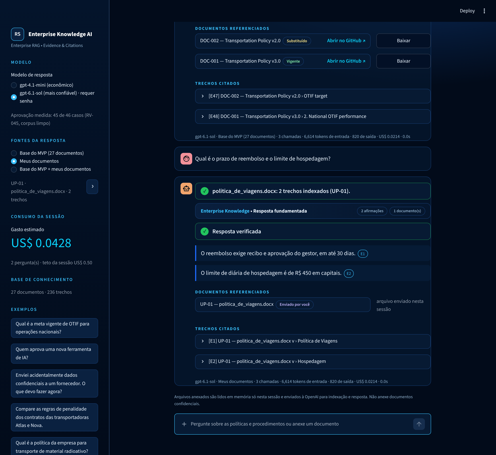
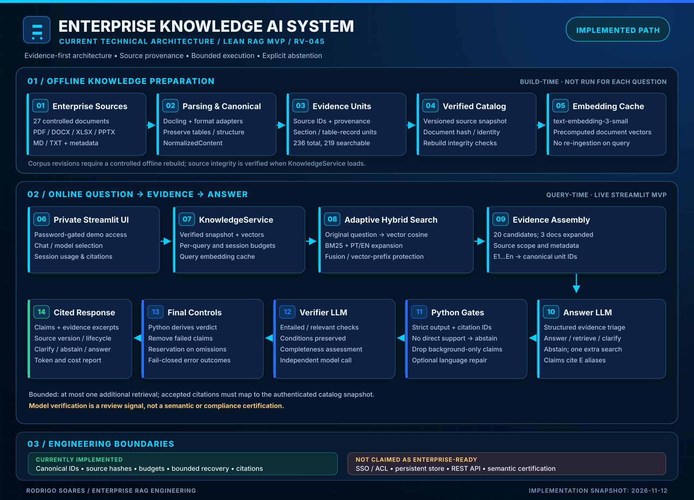
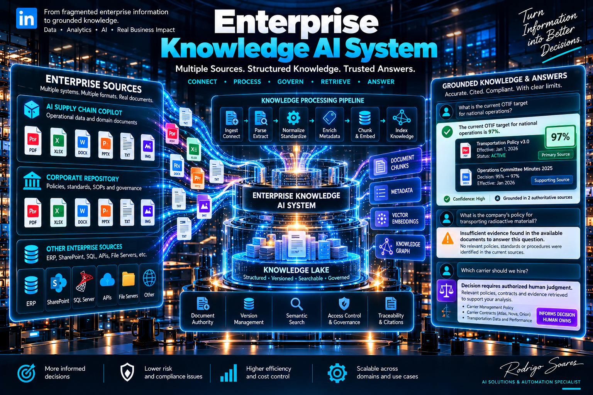
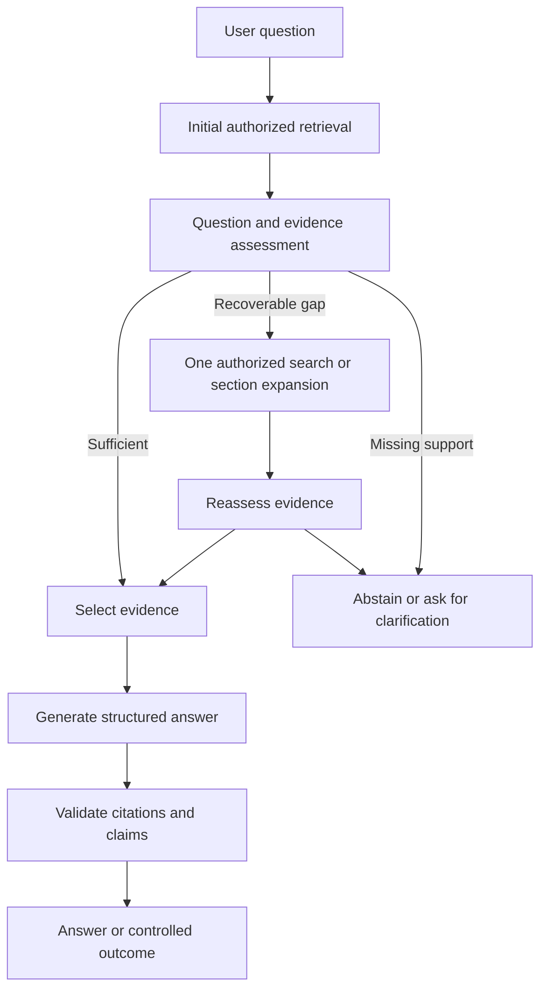
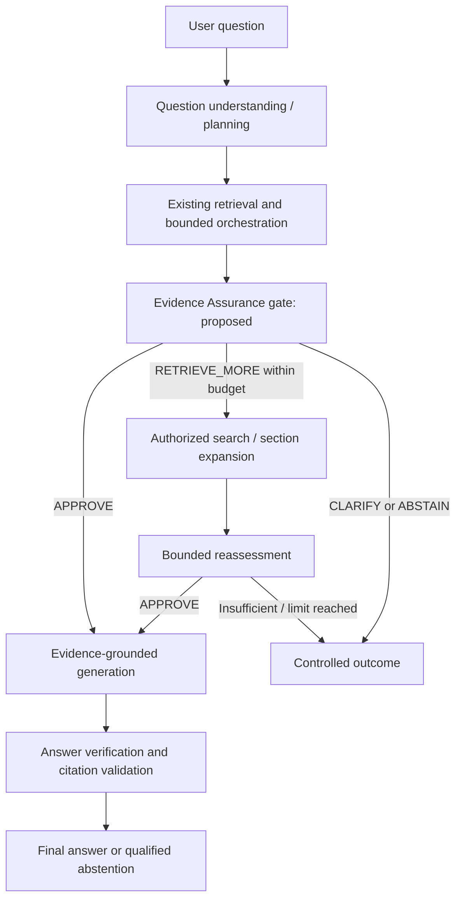

# Enterprise Knowledge AI System

🌐 **Live Application:** [Launch Enterprise Knowledge AI System](https://enterprise-knowledge-ai-system.onrender.com/)
🚀 **Current Stage:** Functional lean RAG MVP with a public Streamlit interface; earlier orchestration experiments remain available
🧪 **Validation:** RV-045 clean corpus (27 documents; 236 evidence units); 45/46 deterministic passes with `gpt-6.1-sol`; semantic review remains necessary
📋 **Next Stage:** Semantic/human review, Q20 multi-policy coverage, and operational hardening of the private demo

The **Enterprise Knowledge AI System** is an Enterprise Retrieval-Augmented Generation (RAG) system designed to transform heterogeneous and fragmented corporate information into a trustworthy, searchable, and evidence-grounded knowledge layer.

The project combines **multi-format ingestion, canonical normalization, structure-aware chunking, semantic retrieval, enterprise metadata, evidence traceability, governance, and systematic evaluation** to support reliable AI-assisted access to organizational knowledge.

> **Evidence before generation. Retrieval quality before answer fluency.**

This README retains the project's evidence-first engineering scope while distinguishing **implemented components**, **experimental integrations**, **recorded measurements**, and **architecture proposals**. The Engineering Overview and MVP diagram reflect `main` as of **12 November 2026**. Later sections preserve dated research and experimental results; measured deterministic passes are not a production certification.

## Run the MVP

### Online

**[enterprise-knowledge-ai-system.onrender.com](https://enterprise-knowledge-ai-system.onrender.com/)**, deployed on Render from `main`.

- Ask questions about the 27 corporate documents with `gpt-4.1-mini`; no login is required.
- `gpt-6.1-sol` is unlocked with an access password in the sidebar.
- Each answer lists the referenced documents, with a download button and a link to the file on GitHub.
- Attach your own files (`.pdf`, `.docx`, `.xlsx`, `.pptx`, `.md`, `.txt`) with the **+** button. They are read in memory for that session only and their text is sent to OpenAI, so do not attach confidential documents.
- Spending is capped per question, per session and per day. The free Render instance sleeps when idle: the first visit can take about a minute to start.

Deployment details: [RENDER_MVP_DEPLOYMENT.md](docs/validation/RENDER_MVP_DEPLOYMENT.md).

### Locally

```powershell
pip install -r requirements.txt
$env:OPENAI_API_KEY = "..."
streamlit run app/frontend/main.py
```

A question is answered from the 27-document corpus by the lean pipeline (retrieve → answer → verify), with a citation for every claim and cost ceilings per question, per session and per day. See [RV-044](docs/architecture/19_rv044_lean_v2_and_answer_criteria.md) for the measured results and [RV-045](docs/architecture/20_rv045_clean_corpus_and_mvp_interface.md) for the interface and the cleaned corpus. The sections below describe the earlier experimental stages.



## Engineering Overview

The architecture separates **offline construction of a verified evidence catalog** from **online answering of one question**. Offline, enterprise documents are parsed, normalized into a canonical model, split into citable evidence units and frozen in a hashed catalog with its embeddings. Online, the lean pipeline retrieves, assembles the evidence, asks the model for cited claims, checks them in Python and has a second call verify every claim.

| Layer | Implementation in the MVP |
|---|---|
| Enterprise Sources | 27 documents: PDF, DOCX, XLSX, PPTX, Markdown, text; registry with version, status and authority |
| Corpus gate | `audit_corpus_content` blocks evaluation-harness text inside documents |
| Parsing | Docling; native XLSX parser with declared headers; one ingestion router |
| Canonical Model | Application-owned blocks with source location and document metadata |
| Evidence Units | Section units and table-record units; titles and duplicates kept but not indexed |
| Verified Catalog | Snapshot with content hashes (236 units, 219 searchable), verified on every load |
| Embeddings | OpenAI `text-embedding-3-small`, cached and keyed to the units |
| Retrieval | NumPy cosine + BM25 with PT→EN term expansion, RRF with protected vector prefix, top 20 |
| Evidence Assembly | Best 3 documents sent in full; aliases E1…En; document status and authority rank |
| Answer | One structured call: evidence triage, decision (answer / retrieve / clarify / abstain), cited claims; one bounded recovery |
| Deterministic Gates | Citation mapping, no-direct-evidence refusal, background-only claims removed, answer-language check |
| Verification | Independent call per claim (entailed, relevant, conditions preserved); verdict derived in Python |
| Response | Verified answer, answer with reservations, clarification or abstention; sources with passage text |
| Cost Control | Budgeted client; ceilings per question and per session |
| Evaluation | `answer_criteria.yaml` (46 cases), deterministic scorer, batch runner; 45 of 46 pass with `gpt-6.1-sol`; semantic audit 40 of 46 at strict review |
| CI | Offline GitHub Actions workflow: tests, corpus audit, frontend and deployment manifest checks |
| Application | Streamlit interface over `KnowledgeService` (one per session); command line |
| Deployment | `render.yaml` blueprint for a private demo behind a shared password; manual deploys |
| Not in the MVP | SSO and user accounts, rate limiting, account-wide budget, REST API, persistent store, per-document access control |



The branded diagram depicts the **implemented lean MVP** (RV-045). Its version-controlled vector source is [`architecture-overview.svg`](docs/images/architecture-overview.svg), with a [standalone HTML preview](docs/images/architecture-overview.html). For the engineering contracts, operational sequence, invariants and limitations, see **[Current Lean MVP Architecture — Technical Specification](docs/architecture/21_current_lean_mvp_architecture.md)**. Earlier Stage-1/v3/v4.2 experiments remain available for audit and are **not** part of this live path.

## Trustworthy Enterprise RAG Principle

The system is designed around a responsibility chain:

```text
Enterprise Knowledge
        ↓
Canonical Representation
        ↓
Structure-Aware Retrieval Units
        ↓
Search & Retrieval
        ↓
Evidence Ranking / Context Assembly
        ↓
Evidence Sufficiency Assessment (proposed default gate)
        ↓
Grounded Generation
        ↓
Claim Review / Citation Validation
        ↓
Answer / Qualified Abstention
```

The guiding rule remains:

> **Retrieve evidence → establish context → generate from evidence → cite the source → abstain when evidence is insufficient.**

The LLM is not treated as an enterprise system of record. Retrieved content is **data**, not an instruction source. Source authority, date, status, access permissions and provenance must be resolved through explicit contracts rather than assumed from fluent model output. No similarity score is a probability of factual truth.

## The Core Idea

> **Enterprise RAG is not primarily a generation problem. It is an evidence problem.**

Fluent answers are not sufficient if the system retrieves the wrong document, ignores document authority, loses spreadsheet structure, confuses current and obsolete information, omits a necessary source or cannot prove where an answer came from.

The system treats retrieval, provenance, document structure, evaluation, authority, and governance as first-class architectural concerns rather than decorative features surrounding a language model.

The next architectural question is more demanding than basic Top-K retrieval: **does the available evidence set cover every requirement that must be established to answer the user's question correctly?** The proposed Evidence Assurance stage is intended to assess that question before generation, without access to the Golden Set answer key at runtime.

## System Overview

The engineering diagram above explains how the system is structured. The complementary product-level view shows the Enterprise Knowledge AI System as an intelligence layer over heterogeneous knowledge sources.



## Table of Contents

- [Engineering Overview](#engineering-overview)
- [Current MVP Technical Specification](docs/architecture/21_current_lean_mvp_architecture.md)
- [Trustworthy Enterprise RAG Principle](#trustworthy-enterprise-rag-principle)
- [The Core Idea](#the-core-idea)
- [Overview](#overview)
- [Current Status](#current-status)
- [Enterprise Knowledge Sources](#enterprise-knowledge-sources)
- [Canonical Document Model](#canonical-document-model)
- [Structure-Aware Chunking](#structure-aware-chunking)
- [Retrieval Architecture](#retrieval-architecture)
- [Orchestration & Evidence Pipeline](#orchestration--evidence-pipeline)
- [Real-World Retrieval Validation](#real-world-retrieval-validation)
- [Corpus Validation — RV-032 to RV-034D](#corpus-validation--rv-032-to-rv-034d)
- [Retrieval Benchmarks — RV-035 and RV-036](#retrieval-benchmarks--rv-035-and-rv-036)
- [Ground Truth & Evaluation](#ground-truth--evaluation)
- [Governance & Traceability](#governance--traceability)
- [Proposed Evidence Assurance](#proposed-evidence-assurance)
- [Technology Stack](#technology-stack)
- [Project Structure](#project-structure)
- [Getting Started](#getting-started)
- [Automated Tests](#automated-tests)
- [Engineering Practices](#engineering-practices)
- [Roadmap](#roadmap)
- [Current Development Stage](#current-development-stage)
- [Why This Project?](#why-this-project)
- [License](#license)

## Overview

Organizations store critical knowledge across policies, procedures, contracts, spreadsheets, presentations, incident reports, meeting minutes, approval matrices, guidelines, and other disconnected sources.

The Enterprise Knowledge AI System is designed to ingest, organize, retrieve, and ultimately synthesize that knowledge while preserving:

- Source traceability and document identity.
- Authority and lifecycle status.
- Version, effective-date and supersession context.
- Structural relationships among text, lists, tables, slides and sheets.
- Enterprise metadata and applicability conditions.
- Evidence supporting individual claims.
- Explicit uncertainty, clarification and abstention boundaries.
- Controlled access scopes as a future enforcement capability.

The objective is not to allow an LLM to answer from unsupported model knowledge. It is to construct an enterprise knowledge architecture in which each material claim is traceable to evidence that actually supports it.

### Core principles

- **Evidence before generation.**
- **Retrieval quality before answer fluency.**
- **Source traceability and canonical identity.**
- **Document authority and version awareness.**
- **Preservation of source structure.**
- **Explicit handling of insufficient or conflicting evidence.**
- **Deterministic controls when rules are sufficient.**
- **Semantic AI when interpretation adds value.**
- **Evaluation as part of the architecture.**
- **Separate retrieval quality from answer quality.**
- **Reproducibility and bounded operations before feature promotion.**

## Current Status

The project has moved beyond architecture and dataset design into a **functional lean RAG MVP** with a private Streamlit interface, a verified evidence snapshot, cached embeddings, hybrid retrieval, controlled evidence assembly, structured generation, separate claim verification and cited answers. In addition, bounded orchestration and evidence-planning modules have undergone local tests and pilot experiments; these should not be confused with the default CLI path.

A controlled synthetic enterprise repository of **27 physical documents** has been parsed into **158 chunks** in the RV-034/RV-035 experimental configuration. All **36 Golden Set A questions** have their expected document IDs present; this is document availability, **not** proof of complete semantic coverage.

| Capability | Status | Important boundary |
|---|:---:|---|
| Enterprise universe and corpus design | ✅ | Controlled synthetic facts and document roles |
| PDF ingestion / parsing | ✅ | Parser-specific limitations remain measurable |
| DOCX ingestion | ✅ | Headings and block provenance |
| XLSX native parsing | ✅ | Preserve sheet/table/formula semantics where available |
| PPTX parsing / enrichment | ✅ | Cross-slide chunks need provenance review |
| Markdown / TXT ingestion | ✅ | `.txt` supported by current source discovery and router updates |
| Canonical document representation | ✅ | Downstream contracts are application-owned |
| Structural metadata preservation | ✅ | Not equivalent to runtime document authority |
| Structure-aware chunking | ✅ | RV-034: zero structural errors in audited corpus |
| Search-text construction | ✅ | Used for vector indexing |
| OpenAI embeddings | ✅ | Real model calls exercised |
| Vector index and cosine similarity | ✅ | In-memory, process-local |
| Multi-document retrieval | ✅ | Globally unique chunk IDs |
| Lexical BM25 retrieval | ✅ | Poor raw PT-to-EN coverage observed |
| PT/EN lexical function-word filtering | ✅ | Filtering is not translation |
| Controlled bilingual query expansion | 🧪 | RV-036 experiment only; not promoted |
| Reciprocal Rank Fusion | ✅ | Can degrade ranking without safeguards |
| Document diversification | ✅ | Does not prove evidence completeness |
| Cross-encoder reranking | 🧪 | Mixed historical results; opt-in |
| Vector-prefix evidence protection | 🧪 | RV-036 candidate, not standard runtime |
| Metadata filtering / authority at runtime | 📋 | Registry metadata exists, enforcement incomplete |
| Evidence context assembly | ✅ | Bounded expansion; contextual sufficiency not guaranteed |
| Structured LLM generation | ✅ | Real generation; semantic correctness not approved |
| Structural citation validation | ✅ | Citation IDs and schema; not entailment |
| Explicit abstention contract | ✅ | Q29 behavior not yet established by RV-035/036 |
| Lean MVP orchestration | ✅ | `run_lean`: retrieve → answer → verify; at most one additional retrieval |
| Stage-1 bounded orchestration | 🧪 | Historical code/tests and local proofs; not the live MVP path |
| Evidence planning/pipeline | 🧪 | Connected experimental paths, not production gate |
| Evidence Assurance post-orchestrator | 📋 | New proposed evaluation/sufficiency stage |
| Lean claim verification | ✅ | Separate LLM review and Python filtering; not semantic certification |
| Deeper claim review and controlled repair | 📋 | Historical architectural proposal; independent acceptance pending |
| Golden Set A | ✅ | 36 questions; 35 positive retrieval cases; Q29 abstention |
| Corpus alignment checks | ✅ | RV-034D: 81/81 selected checks, 5 review flags |
| Full semantic corpus approval | 📋 | Not established by targeted checks |
| Document-level retrieval benchmarks | ✅ | RV-035 and RV-036 recorded |
| Streamlit frontend | ✅ | Password-gated private demo; no enterprise identity management |
| REST API and persistence | 📋 | Future deliverables |
| Multiuser ACL and operational security | 📋 | Not claimed as implemented |

**Legend:** ✅ implemented in stated scope · 🧪 experimental / validation in progress · 📋 proposed / not delivered. Successful parsing, unit tests or API execution do not establish production readiness.

## Enterprise Knowledge Sources

The system intentionally targets heterogeneous enterprise information rather than a single file type:

- **PDF:** policies, reports, formal agreements, contracts and controlled records.
- **DOCX:** standard operating procedures, guidelines, documents with heading hierarchies.
- **XLSX:** approval matrices, KPI dictionaries, action trackers and other structured workbooks.
- **PPTX:** committee minutes, presentations, slide-based records and enablement materials.
- **Markdown:** internal operational notes and usage guidelines.
- **TXT:** plain-text guidelines where explicit paragraphs/sections can be recovered.

The current `discover_sources` function accepts `.pdf`, `.docx`, `.xlsx`, `.pptx`, `.md`, and `.txt` and enforces document-ID naming and uniqueness. Supported ingestion routing should always be validated against the installed code and source file type.

The synthetic corpus is organized into documents `DOC-001` through `DOC-027`, representing transportation and supplier policies, supplier onboarding SOPs, confidentiality and security controls, historic policies, carrier contracts, incident reports, committee records, approval matrices, AI governance, AI security, procurement guidance, workforce training and operational guidelines.

A superseded policy remains available for historical comparisons but must not automatically override the active governing version. A guideline is not a corporate policy. A draft or synthetic proposal is not automatically approved operational authority.

### Corpus inventory and evaluation roles

| Group | Example documents | Retrieval challenge |
|---|---|---|
| Transportation governance | DOC-001, DOC-002, DOC-003 | Current vs superseded authority, escalation, OTIF |
| Supplier risk and onboarding | DOC-004, DOC-008, DOC-022 | Required evidence vs high-level policy, version lookup |
| Information security | DOC-005, DOC-006, DOC-007, DOC-010, DOC-011 | Confidentiality, conflicting legacy SOP, authority |
| Structured references | DOC-012, DOC-013, DOC-021 | XLSX approvals, KPI definitions, action status |
| Carrier contracts | DOC-014, DOC-015, DOC-016 | Entity specificity, delay clauses, force majeure |
| Operational incidents | DOC-017, DOC-018, DOC-019, DOC-020 | Historical decisions, precedent and distractors |
| AI governance | DOC-023, DOC-024, DOC-025, DOC-026, DOC-027 | Policy/standard/guideline separation |

These are synthetic evaluation documents, **not signed real contracts or actual corporate records**. The `canonical_facts.yaml`, `document_registry.yaml`, and `golden_questions.yaml` files are control/evaluation assets and should **not** be indexed as answer evidence.

## Canonical Document Model

Different formats express structure differently. A spreadsheet is not a PDF, a slide deck is not a Word document, and a table should not be treated as an arbitrary paragraph.

The ingestion layer therefore converts heterogeneous source formats into a **canonical, structure-preserving representation**:

```text
Source Document
      ↓
Ingestion Router / Format Adapter
      ↓
Normalized Content
      ├── Document Identity and Source Path
      ├── Text Blocks
      ├── Table Blocks
      ├── List / Hierarchical Blocks
      ├── Images / Described Elements (where supported)
      ├── Structural Location
      │    ├── page / section
      │    ├── slide
      │    └── worksheet / table / cell
      └── Source Block IDs and Document Order
      ↓
Canonical Retrieval Chunks
```

The canonical boundary prevents downstream retrieval from depending directly on parser-native types. The system's own types carry stable identity and structural information; they are the contracts to be tested.

A future document snapshot will need immutable or version-bound identity in addition to the current document/order chunk IDs, because the latter do not prove that a chunk's text has not changed across versions.

## Structure-Aware Chunking

The system does not treat chunking as arbitrary fixed-length slicing. `StructureAwareChunker` creates retrieval units that preserve relevant source boundaries such as headings, sections, paragraphs, lists, tables, worksheets and slide metadata.

```text
Canonical Document
        ↓
Structure-Aware Chunker
        ↓
RetrievalChunk
        ├── chunk_id / document_id / order
        ├── text
        ├── section_path
        ├── source_block_ids
        ├── page_numbers
        ├── slide_numbers
        └── sheet_names
        ↓
Search Text
        ↓
Indexing
```

The production objective is to create semantically useful units without losing provenance. The experimental target size in RV-034 was 1,200 characters, with a maximum of 1,800 characters; these are **chunking parameters**, not universal recommendations.

RV-034 found nine chunks under 100 characters, two chunks spanning multiple slides and four groups of identical content. RV-034C inspected 26 unique flagged chunks across 14 documents. The review found structural segmentation issues to evaluate, such as a heading separated from a table, and duplicated synthetic boilerplate. It **did not prove a content-loss defect** in the inspected context.

### Structure-sensitive evidence

In `DOC-024`, the title **3. Minimum controls** forms a 19-character text chunk while its control matrix occupies the next table chunk. Both are present; a useful future retrieval unit may need to preserve the heading-to-table relationship.

In `DOC-020`, a 694-character chunk spans three slides; in `DOC-026`, a 1,249-character chunk spans four slides while a separate 84-character governance note remains. These cases motivate slide-level precision checks, not an untested global chunker rewrite.

Repeated `Document control` notices are present in several synthetic policies. Duplicated contract clauses can be meaningful when each carrier's document remains authoritative for its own terms; deduplication must preserve per-document provenance.

## Retrieval Architecture

The target retrieval design deliberately goes beyond pure vector similarity:

```text
User Question
       ↓
Original Vector Query ──────┐
                            ├── Candidate Fusion (RRF)
Filtered BM25 Query ────────┘
       ↓
Document-aware Selection
       ↓
Evidence Context Builder
       ↓
Structured Answer Generation
```

This describes the main default demonstration path. Experimental rerankers, saved evidence planners and future Assurance gates must be configured separately and should not be presented as default capabilities.

### Vector retrieval

The implemented semantic retrieval foundation includes retrieval-oriented chunk search text, real OpenAI embeddings, normalized embedding vectors, a NumPy-backed index, query embeddings, exact cosine similarity and ranked retrieval candidates.

Vector similarity is a **ranking score**, not a percentage of relevance, truth, confidence or applicability. The vector branch receives the original user question without deterministic lexical translation.

In RV-035, the model `text-embedding-3-small` was evaluated over the synthetic 27-document corpus. It reached 93.10% document-level Recall@5 on 35 positive-evidence questions. That is a strong baseline for this **specific** dataset, not a generalized production guarantee.

### Lexical retrieval

BM25 supports exact terminology, identifiers, policy names, codes and enterprise vocabulary. Query filtering removes selected Portuguese/English function words without translating substantive Portuguese tokens.

RV-035 exposed a significant language mismatch: the questions were in Portuguese while much of the corpus was in English. The lexical branch returned empty results for 23 of 36 queries. RV-036 explored a deterministic PT→EN glossary; empty lexical queries dropped to zero, but increased candidate recall did **not** automatically improve answer-relevant ranking.

This result argues for evaluating the lexical branch as a distinct component, rather than assuming that the presence of a BM25 index makes hybrid search superior to vector search.

### Metadata retrieval

Metadata-aware filtering is designed to support:

- Document type and domain.
- Source and document identity.
- Version and effective date.
- Lifecycle state: active, superseded or historical.
- Authority and supersession relationships.
- Organizational access scope when ACL is implemented.
- Question-specific applicability constraints.

`DocumentRegistry` models authority and lifecycle, but the default terminal `build_service` does not yet impose full runtime metadata governance. Do not infer that simply storing registry metadata prevents retrieval of superseded or lower-authority content.

### Fusion and reranking

The implemented fusion uses **Reciprocal Rank Fusion (RRF)** with a document diversification option. Candidate depth and fusion score are engineering controls, not semantic support judgments.

The optional cross-encoder reranking work includes fixed replays, candidate scoring and prefix-preserving selection. RV-013 recorded mixed performance and did not justify unconditional promotion.

RV-035 and RV-036 show that an additional retrieval branch can **harm** coverage by displacing a useful document from the Top-5. Hence every promoted fusion strategy should be checked for per-question regressions and evidence-set completeness, not only higher average relevance.

### Current runtime context and generation

**Historical CLI pipeline, not the active Streamlit MVP:** `build_service` assembles a hybrid retriever and injects `ShortDocumentContextBuilder`, selecting five document-diverse anchors. The current MVP instead uses `KnowledgeService` → `AdaptiveEvidenceUnitRetriever` → `run_lean`, with top-20 retrieval and expansion of the top three documents.

The project also has direct `RagService` construction with a different default `EvidenceContextBuilder`. These configurations are separate. Character limits do not constitute approved token budgets, and passage expansion does not guarantee that the right clause or evidence unit reaches the model.

The terminal app parses/indexes documents at startup and reuses in-memory indexes per process. A fresh process repeats ingestion and embedding. This matters when comparing wall time, provider cost and question latency across runs.

See the historical [current architecture checkpoint](docs/architecture/03_current_architecture_and_contracts.md); it was written at RV-016 and should be read as a dated snapshot, not a description of every later prototype.

## Orchestration & Evidence Pipeline

The repository includes `app/orchestration/` modules for bounded planning, evidence assessment, snapshots and evidence pipeline integration. The system's development has progressed beyond the RV-016 architectural proposal, but **the default `ask_knowledge` execution path has not been redefined to use all of these experiments**.

### Implemented experimental building blocks

- Typed, bounded orchestration contracts and a coordinator implemented for Stage-1 investigations.
- Snapshot-bound evidence handling with explicit chunk identity and provenance.
- Evidence planning and diagnostic contexts for ORC-001 through ORC-004.
- Evidence-oriented answer generation and a connected experimental Evidence Pipeline.
- Local replays and selected live-model pilot outputs with structured traces.
- Separation of deterministic validation from semantic model interpretation.

These building blocks should be assessed against their own saved results and test scope. A coherent LLM-generated answer does not automatically establish correct claim support or sufficient retrieval.

### Stage-1 design intent

The bounded workflow is designed around controlled actions and limits, rather than an unrestricted autonomous agent:



The diagram represents the architectural target and experimental direction; it is **not** a claim that all decision paths are currently deployed end to end.

### Evidence and execution contracts

A sound orchestration interface should identify the question, corpus snapshot, authorized scope, considered chunks, unmet evidence requirements, selected evidence and allowed next action. The LLM may propose a structured assessment; code validates its IDs, allowed actions and cumulative budgets.

Source content cannot authorize new tools or redefine the controller's execution limits. Prompt instructions embedded in retrieved documents remain untrusted data.

A selection/assessment is not an answer. E1/E2-style citation identifiers should be generated from the final selected evidence set, and each revision of that set must generate a new binding or context hash.

### Experimental boundaries

- Stage-1 tests do not by themselves prove deployment through the default CLI.
- Real LLM calls demonstrate pipeline integration, not semantic soundness of all claims.
- The synthetic corpus enables controlled tests but should not be confused with enterprise deployment.
- Cumulative token/deadline budgets, fail-closed outcomes and observable traces remain central for any future promotion.
- The new proposed Evidence Assurance step extends bounded orchestration; it must not duplicate existing planner responsibilities or give uncontrolled autonomy to an extra LLM.

## Real-World Retrieval Validation

Retrieval validation is maintained as a progression of increasingly demanding benchmarks rather than isolated successful smoke tests.

### RV-001 — Real Vector Retrieval / DOC-005

The first live experiment validated the single-document path:

```text
Enterprise PDF → Canonical Normalization → Structure-Aware Chunking
               → OpenAI Embeddings → NumPy Vector Index
               → Cosine Similarity → Top-K Retrieval Candidates
```

**Result: PASS.** It also exposed the need for globally unique chunk identifiers before robust multi-document indexing.

### RV-002 — Multi-document Vector Retrieval

Global chunk identities such as `DOC-005::chunk-00001` were implemented and validated in a shared vector index spanning five competing enterprise documents.

| Metric | Historical vector-only baseline |
|---|---:|
| Hit@1 | 80.0% |
| Hit@3 | 100.0% |
| Hit@5 | 100.0% |
| MRR | 0.8667 |

**Result: PASS** within the five-document scenario.

### RV-003 — Golden Set A / Multi-Format Vector Retrieval Baseline

The initial multi-format materialization covered **10 documents** and produced **79 RetrievalChunks with 79 unique IDs**. Golden Set A contained 36 questions, but only 14 had the requisite physical documents in that checkpoint. Thirteen had positive expected evidence and were retrieval-scored; Q29 remained a negative/abstention question.

| Metric | Historical vector-only baseline |
|---|---:|
| Hit@1 | 76.9% |
| Hit@3 | 100.0% |
| Hit@5 | 100.0% |
| Recall@1 | 43.6% |
| Recall@3 | 87.2% |
| Recall@5 | 92.3% |
| MRR | 0.8846 |

The former Hit@1 misses Q05, Q21 and Q25 had expected evidence at rank 2. These measurements are retained for historical continuity; they are **not directly interchangeable** with the 27-document RV-035 benchmark.

See `docs/validation/RETRIEVAL_VALIDATION.md` for the historical experiment record.

### RV-004–014 — Hybrid retrieval and context experiments

These experiments introduced and compared lexical retrieval, RRF, diversity, prefix preservation, reranking and bounded context assembly. RV-013 produced mixed reranker results and did not justify promotion to a default policy.

RV-014 replayed 25 development cases with five anchors. Group B reference coverage increased from 13/15 to 15/15 in expanded contexts. This measured coverage of references in the context, **not** grounded answer correctness.

Historical references include `docs/validation/RV013_ANALYSIS.md` and `docs/validation/RV014_ANALYSIS.md`.

### RV-015 — Structured answer contract

The answer layer validates JSON structure, allowed fields, citation IDs and the binding between question and rendered context. An `answered` result requires cited claims; an `abstained` result requires an explanation and no claims. The historical targeted local execution reported 44 passing tests.

The structural contract prevents malformed outputs; it does not establish entailment, answer completeness, authority resolution or semantic support.

### RV-016 — Live generation and saved-context comparison

The terminal application connected retrieval to real LLM generation, recording question, context, answer, source metadata, usage and latency.

The sharing-policy diagnostic revealed missing controls in the initial retrieved context. A broader context increased from 10 to 45 passages; observed generation tokens rose from approximately 2,075 to 7,302. Required policy material became available, but generated answers could still drift into unrelated AI-use rules or omit material conditions.

Saved-context tests with `gpt-4.1-mini-2025-04-14` and `gpt-4.1-2025-04-14` did not establish semantic approval. A single result per arm is not a general model comparison. `CONTRACT_VALID` proves contract/schema validity only.

### Subsequent bounded-orchestration and evidence investigations

Following RV-016, the project developed Stage-1 bounded orchestration contracts, case definitions for ORC-001–004, evidence planners, evidence answer generation and connected pipeline experiments.

Selected milestones reported in the development record include:

- Controlled minimal vs broader context comparisons on ORC-001 and ORC-003.
- Stage-1 planning and context diagnostics with frozen corpus snapshots.
- Experimental `ask_evidence` and generation scripts.
- Live-model evidence answer runs, followed by connected Evidence Pipeline runs.
- An earlier locally reported full test run of **805 passed, four warnings** after Evidence Pipeline integration.
- Additional corpus-building/ingestion tests subsequently reported separately.

These are **development checkpoints**, not an assertion that all later experiments are committed to the default branch or integrated into one production application. The generated `PROJECT_AUDIT.md` contains a dated repository snapshot and must be regenerated when code changes.

## Corpus Validation — RV-032 to RV-034D

### RV-032 — Controlled materialization and Golden Set preflight

The physical enterprise corpus was expanded to 27 synthetic documents spanning PDF, DOCX, XLSX, PPTX, MD and TXT. The Golden Set preflight checks whether document identifiers and evaluation roles are present. Local preflight JSON/CSV reports are development artifacts and should not be blindly committed.

Golden Set A has 36 questions; 35 require positive supporting evidence, while Q29 intentionally tests absence of a radioactive-material transportation policy. Q30 tests the boundary against inventing an authoritative carrier selection decision.

### RV-033 — Corpus ingestion

The multi-format local ingestion step exercised the physical corpus through the ingestion router and structure-aware chunker. It established a corpus materialization path suitable for subsequent structural diagnostics. RV-033's exact pass criteria should be taken from its saved report rather than inferred from later RV-034 metrics.

### RV-034 — Structural quality audit

The RV-034 local report recorded:

| Measurement | Value |
|---|---:|
| Documents processed | 27 |
| Retrieval chunks | 158 |
| Unique chunk IDs | 158 |
| Total chunk characters | 44,112 |
| Structural errors | **0** |
| Review flags | **15** |
| Expected document availability | 36/36 questions |
| Semantic coverage verified | **No** |
| API calls | 0 |

The audit used 1,200-character target chunks and 1,800-character maximum chunks. Nine small chunks, two multi-slide chunks and four groups of identical chunk text were review flags, not structural failures.

### RV-034B and RV-034C — Contextual review

RV-034B classified review flags by type. RV-034C inspected **26 distinct flagged chunk IDs across 14 documents**, including neighboring chunks. Findings included:

- Title-only chunks followed by intact tables, e.g., `DOC-024` and `DOC-005`.
- A multi-slide committee presentation (`DOC-020`) and an AI training deck (`DOC-026`).
- Repeated synthetic document-control boilerplate across policies.
- Legitimately shared contract clauses, with distinct carrier-specific penalty terms.
- Proposed synthetic contract and historical-action details that need authority-aware review.

The inspected evidence did not demonstrate lost text. It did indicate potential retrieval/citation quality challenges. Changes to the chunker should follow controlled benchmark comparison, not the mere presence of review flags.

### RV-034D — Selected canonical fact alignment

The local alignment report recorded **81/81 checks passed**, zero deterministic failures and **five human-review flags**. The flags concern contractual proposed mechanics in DOC-014/015/016 and historical proposed actions/status details in DOC-019/020.

The check scope was deliberately targeted: registry IDs and formats, Golden Set expected-document availability, selected OTIF/version claims, carrier identities and yes/no clause presence. It did **not** verify every proposition in every synthetic document or finalize all `expected_answer_specification` fields.

The canonical facts deliberately delegate exact penalty mechanics to the applicable contract. Percentages can be retrieved from a synthetic source, but the system should preserve source qualifications and avoid promoting unapproved proposals to definitive corporate policy.

## Retrieval Benchmarks — RV-035 and RV-036

### RV-035 — Real embedding retrieval baseline

The benchmark exercised **27 documents / 158 chunks** and all 36 Golden Set A queries, with **35 positive-evidence queries scored for retrieval**. Q29 was excluded from positive retrieval metrics because its correct behavior is abstention, which requires a separate assessment.

Real embeddings used `text-embedding-3-small`; no answer-generation calls were made. Measurements were at **document level** rather than chunk/span-level entailment.

| Metric | Vector | Filtered BM25 | Hybrid + diversity |
|---|---:|---:|---:|
| Hit@1 | **71.43%** | 5.71% | 68.57% |
| Hit@3 | 94.29% | 20.00% | 94.29% |
| Hit@5 | 100.00% | 22.86% | 100.00% |
| Recall@5 | **93.10%** | 21.90% | 90.71% |
| MRR@5 | **0.8400** | 0.1295 | 0.8210 |
| FullEvidence@5 | **82.86%** | 20.00% | 77.14% |

`Hit@5 = 100%` means **at least one expected document appeared in Top-5** for each scored question; it does **not** mean all required documents were retrieved. The vector control had complete expected-document coverage for **29/35** questions, versus **27/35** for the hybrid.

The unmodified hybrid therefore did **not** outperform the vector control in this corpus. In several questions, lexical fusion displaced or demoted a useful source. This is a measured regression against the benchmark, not evidence that hybrid retrieval is inherently inferior in general.

### RV-036 — Bilingual query expansion and vector-prefix protection

The second benchmark froze the physical corpus by source hashes and compared vector retrieval, existing hybrid, glossary-expanded PT→EN hybrid and bilingual hybrid with the first three distinct vector documents protected.

The lexical glossary was deterministic and intentionally limited to domain terms. It was not a complete machine translation system. The experiment produced detailed candidate traces and a local embeddings cache for replay.

| Metric | Vector | Hybrid control | Hybrid bilingual | Hybrid protected-3 |
|---|---:|---:|---:|---:|
| Hit@1 | 68.57% | 68.57% | 68.57% | 68.57% |
| Hit@3 | 94.29% | 94.29% | 91.43% | 94.29% |
| Hit@5 | 100.00% | 100.00% | 100.00% | 100.00% |
| Recall@5 | 93.10% | 90.71% | 91.90% | **95.00%** |
| MRR@5 | 0.8257 | 0.8210 | 0.8186 | **0.8257** |
| FullEvidence@5 | 82.86% | 77.14% | 80.00% | **85.71%** |

The glossary reduced lexical queries with zero hits from **23 to 0**, but introduced rank trade-offs. Protecting the first three vector documents reached full expected-document coverage for **30/35** queries. This is a candidate result, not an automatic promotion.

The saved report recorded **six baseline ranking drift records across Q12, Q13 and Q18**, spanning vector/control comparisons. Even where aggregate recall was unchanged, exact rank reproducibility was not complete. The experiment status was `COMPARISON_COMPLETE_BASELINE_DRIFT_REVIEW`.

Important observations:

- Q18 gained an incident committee evidence source under the proposed protected strategy.
- Q20 recovered a second information-sharing policy under the proposed protected strategy.
- Q28 lost the historical committee minutes DOC-019 under protected-3 selection.
- Q30 benefits from a different candidate mix and illustrates a human-decision boundary.
- Q29 was queried but abstention behavior was not semantically evaluated.

**Architecture decision at this checkpoint:** keep vector-only as a safety benchmark, retain the existing hybrid as a comparison arm, and keep bilingual expansion and prefix protection opt-in pending further evaluation. Do not optimize solely on a single aggregate metric.

### RV-037 — Offline evidence selection analysis (planned / not yet verified)

RV-037 is designed to replay the recorded candidate traces at multiple levels of protected vector documents, compare gains and regressions against the vector control and inspect critical evidence positions without parsing or API calls.

At this README checkpoint, **no RV-037 result file has been supplied or verified**. Thus the section describes the intended next experiment, not a completed milestone.

### Benchmark interpretation and nonclaims

1. Evaluation is restricted to the synthetic corpus and its specific question set.
2. Document-level coverage does not demonstrate chunk/row/span-level support.
3. Lexical result count alone is not a semantic quality metric.
4. RRF reordering can create or resolve omissions; per-question changes matter.
5. A high Hit@K can coexist with incomplete evidence for multi-document questions.
6. Model-generated answers require separate factual and citation evaluation.
7. Q29 intentional abstention and Q30 human decision-boundary behavior require dedicated end-to-end checks.
8. A report's status of `PASS` must be read with its explicit scope.
9. Development-set tuning requires independent held-out tests before promotion.
10. Replaying saved vectors is valid only when corpus identity, model and query text are bound to the cache.

## Ground Truth & Evaluation

Evaluation is a permanent part of the architecture, not a final cosmetic test.

```text
data/ground_truth/
├── canonical_facts.yaml
├── document_registry.yaml
├── golden_questions.yaml
├── orchestration_stage1_cases.json
└── reranking_challenge_b.json
```

- `canonical_facts.yaml` controls the synthetic enterprise universe and intentional unknowns.
- `document_registry.yaml` defines identity, role, format, lifecycle, authority and source relationships.
- `golden_questions.yaml` defines 36 questions, expected document-level evidence, distractors and expected behavior.
- The Stage-1 and reranking challenge files provide focused development/evaluation cases.

The first three ground-truth assets are **not indexed by the RAG as enterprise source documents**. The runtime should derive answers from admissible corpus evidence, not from hidden evaluator keys.

### Evaluation model

```text
Golden Question
      ↓
Expected Evidence / Canonical Facts (evaluation only)
      ↓
System Execution
      ↓
┌────────────────────────────────────┐
│ Retrieval Quality                  │
│ Evidence-Set Coverage              │
│ Applicability / Authority          │
│ Answer Groundedness                │
│ Factual Correctness                │
│ Answer Relevance                   │
│ Citation Correctness and Coverage  │
│ Governance / Policy Compliance     │
│ Abstention / Decision Boundaries   │
└────────────────────────────────────┘
```

The key distinction is between **finding documents**, **selecting the right evidence**, **establishing sufficiency**, **generating a correct answer**, and **verifying support**. Each phase requires its own measurements and failure modes.

### Retrieval metrics

Implemented and recorded retrieval metrics include:

- Hit@K: at least one expected source appears within K.
- Recall@K: fraction of expected sources recovered within K.
- MRR@K: mean reciprocal rank of the first expected source.
- FullEvidence@K: all expected documents are present within K.
- Per-question expected-document and distractor diagnostics.
- Experimental candidate traces and comparison/seed drift reports.

These metrics operate at the scope defined by the experiment. Document-level recall must not be reported as span-level entailment. Q29 is outside positive-evidence metrics and should be explicitly assessed for grounded abstention.

### Answer evaluation: current boundary and next step

Structural answer validation is implemented. Future semantic evaluation must measure:

- Whether each claim is supported by cited source spans.
- Whether conditions, exceptions and qualifiers were preserved.
- Whether document authority, version and temporal validity were respected.
- Whether contradictory documents are acknowledged or resolved correctly.
- Whether the answer covers all material parts of the question.
- Whether a missing enterprise policy causes proper abstention.
- Whether recommendations requiring a human decision remain advisory.
- Whether incomplete evidence triggers a bounded recovery attempt or qualified outcome.

A hybrid evaluator should combine deterministic checks with clearly bounded semantic assessment. An LLM-as-a-Judge is an imperfect assessor, not a cryptographic proof or independent source of truth. Acceptance requires adversarial and held-out cases.

## Governance & Traceability

Enterprise retrieval systems require more than semantic similarity.

The document registry models:

- Stable document identifiers and titles.
- Type, domain and authority level.
- Effective date, status and version.
- Supersedes / superseded-by relationships.
- Expected evaluation roles and source relationships.
- Source-format structural expectations.

The retrieval evidence model preserves chunk identity, source path and (where supported) page, section, slide, sheet and source block references. These are essential for traceability but do not, alone, enforce authority or permissions.

```text
Current / applicable source
      +
Valid source provenance
      +
Relevant and sufficient evidence
      ↓
Grounded answer with citations

Missing / conflicting / unauthorized evidence
      ↓
Recover (if allowed), clarify, abstain, or operational error
```

The default terminal flow has not implemented full runtime ACL, nor does a question/context hash authenticate user permissions or document integrity. Any future Evidence Assurance agent must respect authorized snapshots and must never widen access based on retrieved content.

### Authority boundaries in the synthetic corpus

- DOC-001 is the active transportation policy; DOC-002 is superseded.
- DOC-006 is an active security policy; DOC-011 is a superseded legacy SOP with deliberately conflicting sharing guidance.
- DOC-022 is a current supplier management policy; its checklist is delegated to DOC-008.
- DOC-012 is the approval authority matrix; a high-level procurement policy must not invent its approvers or thresholds.
- DOC-023 and DOC-024 distinguish AI governance obligations from AI security controls.
- DOC-026 is a workforce guide; it provides training details but is not an approval authority.
- DOC-027 is usage guidance, not permission to bypass formal AI governance.
- Q29 intentionally lacks a source policy for radioactive materials and should test abstention.
- Q30 must not produce a fictitious authoritative carrier-selection decision.

Proposed synthetic details in contracts and historical records require explicit status interpretation rather than automatic adoption as universally approved corporate policy.

## Proposed Evidence Assurance

**Status: architecture proposal, not implemented as the default RAG execution stage.**

The proposed **Evidence Assurance Agent** acts as a **post-orchestration, pre-generation sufficiency gate**. The goal is not merely to rerank Top-K passages. It is to determine whether the selected evidence covers the question's material information requirements, whether more authorized retrieval is justified, or whether an answer must be limited, clarified or withheld.

### Why introduce an additional stage?

RV-035/036 revealed cases where:

- The retriever found at least one correct source but missed another required source.
- A ranking/fusion method displaced historically material evidence.
- A source was available in Top-20 yet not retained in the final five-document context.
- A single fixed selection rule benefited one question while harming another.
- Document-level metrics failed to express the sufficiency of the assembled context for multi-document answers.

For example, a question about a change in transportation policy may require the current policy, the superseded policy and the committee rationale. Retrieving only the two policies may be insufficient even if the citations are structurally valid.

### Proposed architecture



The post-orchestrator is **not** intended to make an authoritative business decision. Its role is to evaluate adequacy of retrieved evidence before the generator makes claims.

### Four assessment dimensions

| Dimension | Question | Deterministic / semantic responsibilities |
|---|---|---|
| Relevance | Does the passage concern the requested entities and issue? | IDs/filter rules + semantic applicability |
| Coverage | Are all material information needs evidenced? | Declared requirements + candidate mapping |
| Authority | Are sources applicable, current and appropriately authoritative? | Registry metadata, hierarchy, lifecycle rules |
| Consistency | Do sources conflict or leave an unresolved condition? | Version checks + semantic contradiction review |

### Proposed input / output contracts

The gate should receive a bounded **question envelope**, a validated corpus snapshot, authorized chunk candidates, source metadata, explicitly enumerated evidence requirements and a remaining execution budget. It must not receive evaluation answer keys.

An illustrative structured decision:

```json
{
  "decision": "RETRIEVE_MORE",
  "coverage": "PARTIAL",
  "missing_requirements": ["historical_approval_rationale"],
  "requested_action": {
    "kind": "search",
    "query": "OTIF target change committee approval rationale"
  },
  "approved_chunk_ids": ["DOC-001::chunk-00004"],
  "unresolved_gaps": ["reason for approved change"]
}
```

This is an **illustration**, not an executed model result. Actual contracts must validate enums, known IDs, snapshot binding, hashes and source-span references; cited evidence must be fetched from the authorized catalog rather than invented by the assessor.

### Proposed deterministic and semantic split

**Deterministic enforcement:** source IDs; schema; allowed tools; snapshot membership; authority metadata; lifecycle constraints; cumulative budgets; maximum rounds; terminal outcomes; input/output validation; citation resolution; reproducible execution traces.

**LLM-supported assessment:** question decomposition, applicable evidence identification, semantic coverage, conditional requirements, apparent contradiction and rationale for a focused complementary lookup.

The LLM proposes actions; code decides whether to execute them. The LLM must never grant permissions, redefine retrieval boundaries, increase budgets, or use retrieved documents as instruction authority.

### Proposed decisions

- `APPROVE`: evidence requirements are satisfied within the permitted scope.
- `RETRIEVE_MORE`: exactly one approved complementary search/expansion is justified by a concrete gap.
- `CLARIFY`: a missing user condition materially changes the outcome and cannot be inferred.
- `ABSTAIN`: evidence remains insufficient, unsupported, contradictory or unavailable under the authorized snapshot.
- Operational failures such as timeout/provider error should be explicit errors, not disguised as knowledge abstention.

One supplementary retrieval and one reassessment are reasonable **pilot bounds**; final numeric token/deadline budgets require measurement and configuration. No extra retrieval loop should be triggered after generation in the first iteration.

### Separation from post-generation verification

Evidence Assurance is a **pre-generation** check: *do we have enough reliable evidence to answer?*

Answer Verification is a **post-generation** check: *does each generated claim accurately and completely follow from the approved evidence?*

A claim review cannot recover a missing source if it only sees an incomplete context. Likewise, a complete evidence set does not guarantee the LLM will generate a correct interpretation. Both mechanisms are necessary, independently tested boundaries.

### Acceptance conditions for a pilot

- No runtime access to `canonical_facts.yaml` or `golden_questions.yaml`.
- Reuse existing retrieval and orchestration components; no gratuitous new agent framework.
- Frozen test corpus, snapshots, source hashes and reproducible trace IDs.
- New evaluation cases selected before prompt/policy tuning.
- Explicit false-positive and false-negative gap-detection measurements.
- Improvement in full evidence coverage without unacceptable per-question regressions.
- Correct handling of Q29 abstention and Q30 human-decision boundaries.
- Auditable supplemental searches with strict budget and source scope.
- Claim-level citation support review performed separately after generation.
- Baseline, control arm and rollback path preserved.

### Relation to prior architecture design

The original [bounded semantic orchestration proposal](docs/architecture/04_bounded_orchestration_proposal.md) already anticipates an initial evidence assessment and bounded corrective retrieval. **Evidence Assurance should refine that responsibility**, rather than install an independent, duplicate planner. Its implementation should be a cohesive evaluation gate integrated with the existing coordinator, not an unconstrained second autonomous agent.

The detailed post-orchestration design is intended to be recorded as a separate architecture document before implementation or promotion. The proposal and this README intentionally do not claim that it has already passed RV-037 or a real Evidence Assurance benchmark.

## Technology Stack

| Category | Technologies / Approach |
|---|---|
| Language | Python 3.14 (current observed development environment) |
| Document Parsing | Docling, RapidOCR when applicable, specialized adapters |
| Spreadsheet Processing | openpyxl |
| Embeddings | OpenAI `text-embedding-3-small` in recent tests |
| Vector Search | NumPy, normalized cosine similarity |
| Lexical Search | Project BM25 index; filtered PT/EN lexical queries |
| Fusion / Selection | RRF, document diversification, experimental vector-prefix protection |
| Semantic Scoring | Optional Transformers cross-encoder experiments |
| Ground Truth | YAML and controlled synthetic document corpus |
| LLM Integration | OpenAI generation providers and structured-output contracts |
| Orchestration | Project-owned typed contracts and bounded coordinator prototypes |
| Testing | pytest, offline replays, local/real-model smoke tests |
| Documentation | Markdown, Mermaid, generated project audit |
| Version Control | Git / GitHub |
| Architecture | Modular, layered, evidence-first RAG |
| Evaluation | Deterministic checks plus bounded semantic evaluation (future promotion) |

Additional retrieval infrastructure, web/API interfaces, persistence, background processing or agent frameworks should be justified by concrete measured capability needs, not architectural fashion.

## Project Structure

A simplified view of the repository:

```text
enterprise-knowledge-ai-system/
├── app/
│   ├── ingestion/
│   │   ├── ingestion_router.py
│   │   ├── docling_parser.py
│   │   ├── xlsx_parser.py
│   │   └── registry.py
│   ├── chunking/
│   │   ├── structure_aware_chunker.py
│   │   └── schemas.py
│   ├── evaluation/
│   ├── generation/
│   │   ├── answer_contract.py
│   │   ├── evidence_answer.py
│   │   └── rag_service.py
│   ├── orchestration/
│   │   ├── contracts.py
│   │   ├── coordinator.py
│   │   ├── evidence_planner.py
│   │   └── evidence_pipeline.py
│   ├── retrieval/
│   │   ├── hybrid_retriever.py
│   │   ├── lexical_index.py
│   │   ├── lexical_query_filter.py
│   │   ├── vector_index.py
│   │   └── candidate_fusion.py
│   └── scripts/
│       ├── ask_knowledge.py
│       ├── ask_evidence.py
│       └── project_audit.py
├── data/
│   ├── source/
│   │   └── corporate_repository/
│   │       ├── contracts/
│   │       ├── governance/
│   │       ├── guidelines/
│   │       ├── incident_reports/
│   │       ├── policies/
│   │       ├── references/
│   │       ├── sops/
│   │       └── standards/
│   ├── ground_truth/
│   │   ├── canonical_facts.yaml
│   │   ├── document_registry.yaml
│   │   ├── golden_questions.yaml
│   │   └── orchestration_stage1_cases.json
│   └── corpus_quarantine/  # local review material; not default RAG corpus
├── docs/
│   ├── architecture/
│   ├── images/
│   ├── project_audit/
│   └── validation/
├── tests/
│   ├── unit/
│   ├── integration/
│   └── smoke/
├── README.md
├── requirements.txt
└── .gitignore
```

The detailed repository structure is a moving engineering snapshot. New local benchmark files do not necessarily appear in GitHub until deliberately reviewed and committed. See `docs/project_audit/PROJECT_AUDIT.md` for a generated checkpoint, with its own timestamp and version limitations.

## Getting Started

### 1. Clone the repository

```powershell
git clone https://github.com/RodsSoares/enterprise-knowledge-ai-system.git
cd enterprise-knowledge-ai-system
```

### 2. Create and activate a virtual environment

```powershell
python -m venv .venv
.\.venv\Scripts\Activate.ps1
```

### 3. Install dependencies

```powershell
python -m pip install -r requirements.txt
```

### 4. Configure external services when required

Real embedding and generation calls require an API key and incur provider usage. The scripts read environment variables; a `.env` file is not loaded automatically.

```powershell
$env:OPENAI_API_KEY="your-api-key"
```

> **Security:** Never commit API keys, credentials, corpus-derived private data or provider-sensitive traces. For synthetic public demos, still verify the provenance and content of every generated artifact before publication.

### 5. Run the automated tests

```powershell
python -m pytest -q
```

Run targeted suites for local validation when appropriate, but do not represent a partial test count as the current full-suite result.

### 6. Generate the project audit

```powershell
python -m app.scripts.project_audit
```

The audit provides a repository-derived engineering snapshot. It should be regenerated before a documentation/code commit, **not edited manually**. Its reported Git state and test counts are specific to its generation time.

### 7. Run the terminal application

```powershell
python -m app.scripts.ask_knowledge
```

Enter `/sair` to exit. The default generation model is `gpt-4.1-mini`, configurable through `OPENAI_MODEL` or `--model`. Initial OCR/Docling processing may load or download local assets. Startup indexing is separate from question latency and uses paid embeddings in the default real-API path.

To ask a single question and save a trace to a **new** file:

```powershell
python -m app.scripts.ask_knowledge --question "Quais cuidados a política exige antes de compartilhar dados com um fornecedor externo?" --output docs/validation/SHARING_RUN_local.json
```

The script refuses to overwrite an existing output. Saved results may include source text and should be reviewed before committing, especially when using non-synthetic documents.

### 8. Compare generation using saved context

```powershell
python -m app.scripts.compare_saved_generation --source docs/validation/SHARING_RUN_local.json --output docs/validation/SHARING_COMPARISON_local.json
```

This invokes two paid generations using saved evidence, without repeating parsing or embeddings. It records prompt/usage/timing and structural output, not an automatic verdict of semantic soundness.

### 9. Reproduce current retrieval evaluations

The RV-035/RV-036 evaluations were performed with controlled local scripts and saved reports; the code printed in development conversations is not necessarily part of `app/scripts/` on GitHub. Reproduction requires the exact frozen corpus snapshot, Golden Set revision, embedding model and index configuration.

Current local experiment filenames:

```text
docs/validation/RV034_CORPUS_QUALITY_RESULTS_local.json
docs/validation/RV034C_FLAGGED_CHUNK_CONTEXT_local.txt
docs/validation/RV034D_CANONICAL_ALIGNMENT_RESULTS_local.json
docs/validation/RV035_RETRIEVAL_BASELINE_RESULTS_local.json
docs/validation/RV036_BILINGUAL_RETRIEVAL_RESULTS_local.json
docs/validation/RV036_EMBEDDINGS_local.npz
```

These names describe **local artifacts**. Their presence in a developer worktree does not mean they are tracked in Git. The embeddings cache can be rebuilt from the proper snapshot; do not upload it casually to a public repository.

## Automated Tests

The project uses **pytest** as a regression safety net across ingestion, canonical normalization, specialized parsing, chunking, retrieval, generation, orchestration and integration boundaries.

```text
Unit Tests
    ↓
Component correctness

Integration Tests
    ↓
Cross-layer behavior

Smoke / Real-Service Validation
    ↓
External integration and measured retrieval / generation
```

Routine tests should be deterministic and cost-efficient whenever external calls are not essential. Real-provider experiments complement — rather than replace — regression tests.

### Checkpoint validation status

The previous README reported a full Windows run of **576 passed, four warnings** prior to RV-015/016, plus a partial development-environment suite of 557 passing tests. Those are historical and were not full current-state figures.

Later development checkpoints reported **805 passed, four warnings** after evidence pipeline integration and **810 passed, four warnings** during subsequent corpus work. These are reported local execution results, not a newly rerun full suite for this README revision.

Before committing revised architecture documentation, run and record the full local suite again:

```powershell
python -m pytest -q
```

Targeted answer-layer regression can be run separately:

```powershell
python -m pytest tests/unit/test_answer_contract.py tests/unit/test_rag_service.py tests/unit/test_saved_generation.py -q
```

### Retrieval validation discipline

A successful smoke execution is not automatically retrieval-quality evidence. Meaningful validation records:

- Query and expected behavior.
- Exact corpus/source snapshots and hashes.
- Embedding and search configuration.
- Retrieved chunks and document candidate ranking.
- Ranking scores where relevant, interpreted appropriately.
- Selection, complementing and expansion decisions.
- Inspected evidence and source locations.
- Question-level and aggregate retrieval metrics.
- Regressions and counterexamples, not only gains.
- Outcome quality and next engineering decision.

This creates an auditable progression from technical connectivity to measurable, independently reproducible evidence handling.

## Engineering Practices

The project follows engineering practices intended to keep the system explainable, testable and extensible:

- Layered architecture.
- Modular architecture.
- High cohesion and low coupling.
- Separation of concerns.
- Typed/explicit contracts.
- Structure-preserving source processing.
- Deterministic checks where rules are sufficient.
- Semantic AI when interpretation adds value.
- Evidence provenance and snapshot binding.
- Automated testing with pytest.
- Real-service validation separated from routine tests.
- Ground-truth-driven and negative-case evaluation.
- Automated project audit.
- Incremental delivery.
- Version control.
- Documentation as an engineering artifact.
- Clear distinction between implemented, experimental and proposed.
- Baseline preservation and explicit rollback paths.
- Responsible provider cost and bounded iteration.

### Development principle

```text
Implement capability
      ↓
Run targeted tests
      ↓
Run integration validation
      ↓
Inspect retrieval / evidence behavior
      ↓
Update validation record
      ↓
Run project audit
      ↓
Review documentation
      ↓
Commit
```

The objective is not merely to make a pipeline execute. Each increment should improve the system's capacity to retrieve, preserve, evaluate and explain enterprise evidence reliably.

### Local artifacts and version-control hygiene

The project frequently creates detailed local experiment files. Reports should be classified before committing:

| Artifact | Default recommendation | Reason |
|---|---|---|
| Public architecture Markdown | Review and commit | Durable design decision |
| Updated README | Review and commit | Current repository communication |
| Golden Set and canonical facts | Version consciously | Formal evaluation contracts |
| Benchmark summary Markdown | Commit after review | Durable method, metrics and limitations |
| Local experiment JSON/CSV | Keep local until curated | Large, snapshot-specific; may contain traces |
| `.npz` embedding cache | Keep local | Generated vectors and artifact size |
| Quarantined corpus copies | Review separately | Duplicate or superseded content |
| Project audit | Regenerate, review, then commit if appropriate | Generated snapshot, not hand-edited |

Avoid `git add .` when the worktree contains local caches, quarantined files and experimental reports. Stage explicit paths instead.

## Roadmap

### Current focus

**RV-036 completed; RV-037 offline selection review pending; Evidence Assurance design proposed.**

The retrieval layer has a measured 27-document baseline. The next objective is to improve completeness of selected evidence **without sacrificing authority or causing case-level regressions**.

Core dependencies:

1. Finish offline RV-037 comparison and ranking stability audit.
2. Decide how to handle bilingual lexical expansion and protected vector prefix based on independent evidence.
3. Specify Evidence Assurance contracts and controller integration, reusing bounded-orchestration capabilities.
4. Establish a small held-out suite for sufficiency, irrelevant-evidence rejection, authority and abstention.
5. Connect the approved evidence gate to generation in an opt-in execution mode with cost/latency telemetry.
6. Implement separate claim-level answer verification and citation assessment.
7. Test Q29/Q30 and all critical multi-document cases end to end.
8. Add application-facing API/UI only after the evidence pipeline has stable contracts and observability.

### Bounded semantic orchestration — prototype components and target completion

The earlier README described bounded orchestration as wholly unimplemented at RV-016. Since then, Stage-1 contracts, planning and evidence pipeline experiments have been developed and tested. The original [proposal](docs/architecture/04_bounded_orchestration_proposal.md) remains a design reference, but its initial status header is historical.

The proposed full workflow is still broader than the experimental components. A deterministic coordinator should control authorization, schema, action budgets, timeouts and terminal states. Semantic model steps should be advisory within those boundaries.

The planned path includes initial retrieval/assessment, at most one authorized supplemental search or section expansion in the first release, controlled generation, claim review, at most one bounded repair and a valid final outcome. Approval requires representative semantic evaluation, not only successful integration tests.

### Proposed post-orchestration Evidence Assurance

The new Assurance gate evaluates completeness, relevance, authority and consistency of **the selected context before generation**. It may approve, request one limited recovery, ask for clarification or abstain. This is an architectural direction, not a function already wired into `build_service`.

A separate post-generation verification step checks generated claims against the approved evidence set. Keeping the two concerns separate prevents the post-generation reviewer from being asked to fix missing retrieval evidence by improvising claims.

### Retrieval evolution

```text
Single-Document Vector Retrieval
              ↓
Multi-Document Vector Retrieval
              ↓
Lexical / BM25 Retrieval
              ↓
Candidate Fusion and Diversification
              ↓
Optional Reranking and Query Expansion
              ↓
Evidence Coverage and Stability Evaluation
              ↓
Authority-Aware Evidence Selection
              ↓
Bounded Context Assembly
              ↓
Evidence Assurance (proposed)
```

### Answer and evaluation evolution

```text
Retrieved Evidence
      ↓
Evidence Requirements / Coverage Check
      ↓
Bounded Recovery (when justified)
      ↓
Grounded Generation
      ↓
Claim-Level Verification and Citation Validation
      ↓
Final Answer / Clarification / Qualified Abstention
      ↓
Independent Evaluation and Regression Monitoring
```

The roadmap remains capability-driven. New infrastructure should be introduced only when it improves a measured retrieval, evidence, governance or product requirement.

## Current Development Stage

The Enterprise Knowledge AI System now has a **functional, privately accessible lean RAG MVP**, backed by the cleaned 27-document corpus, while retaining a substantial corpus/evaluation program and historical bounded-orchestration/evidence-pipeline experiments. This status does not imply production security or independently certified semantic accuracy.

What is demonstrated:

- Physical documents can be ingested across six formats and normalized.
- Document chunk IDs and structural provenance can be preserved across a heterogeneous corpus.
- Real embeddings and hybrid retrieval can rank sources against a Golden Set.
- Retrieved evidence can be assembled and passed to a real LLM for structured responses.
- Structured answer contracts and citation IDs can be validated.
- Bounded evidence-oriented workflows have been investigated through code/tests and selected live experiments.
- A controlled 27-document, 158-chunk corpus has been audited with zero structural errors.
- The 35 positive-evidence retrieval questions have measurable baseline results.
- Alternative bilingual and vector-prefix retrieval strategies have been evaluated with explicit per-question trace data.

What is **not** established:

- Production-level factual accuracy or claim-level citation entailment.
- Complete semantic alignment of every synthetic corpus assertion.
- Universal superiority of bilingual BM25 or hybrid fusion.
- A verified runtime Evidence Assurance/post-orchestrator.
- Full runtime authority and multiuser access enforcement.
- A durable production index, API/frontend, operational SLA or enterprise rollout.
- End-to-end approved abstention/decision-boundary behavior for all negative cases.

The portfolio objective is to demonstrate not only the final conversational experience but the engineering discipline required to build a trustworthy enterprise knowledge system from document ingestion to evidence and controlled decisions.

## Why This Project?

Enterprise AI is often demonstrated as a chatbot connected to documents. This project examines a deeper engineering problem:

> **How do we transform heterogeneous enterprise information into evidence that an AI system can retrieve, understand, cite, evaluate, and trust?**

The repository demonstrates work across:

- Enterprise AI architecture.
- Retrieval-Augmented Generation.
- Document intelligence.
- Information retrieval and ranking.
- Data and metadata modeling.
- Software engineering and integration.
- Evaluation engineering and controlled benchmarks.
- Governance, provenance and traceability.
- LLM integration and structured outputs.
- Enterprise knowledge management.
- Bounded evidence planning and decision boundaries.

Together with the broader portfolio, the project represents a distinct AI architecture problem:

- **AI Supply Chain Copilot** — deterministic analytics plus Generative AI for decision intelligence.
- **My LinkedIn Agentic AI System** — bounded agentic orchestration and Human-in-the-Loop authority.
- **Enterprise Knowledge AI System** — evidence-centered enterprise retrieval and grounded organizational knowledge.

The common engineering principle across the portfolio is to assign each responsibility to the component best suited to perform it, rather than delegating every problem to an LLM.

## License

This repository is intended for educational, engineering and portfolio purposes.

The enterprise corpus and business scenarios are synthetic or fictional and designed to demonstrate realistic architecture and retrieval behavior without exposing confidential corporate information. The repository README does not certify any generated synthetic contract as executed, legally effective or approved corporate policy.
