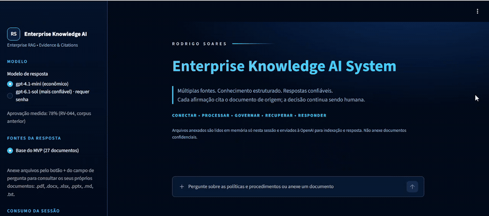

# Enterprise Knowledge AI System

🚀 **Release:** Functional Enterprise RAG MVP · Streamlit web application  
🌐 **Live Demo:** [Launch Enterprise Knowledge AI System](https://enterprise-knowledge-ai-system.onrender.com/)  
🧪 **Validation:** RV-045 · 27 documents · 236 evidence units · 45/46 deterministic checks passed in the recorded `gpt-6.1-sol` run  
🔎 **Engineering focus:** Evidence-grounded answers, document authority, verifiable citations and bounded AI execution

An **evidence-first Enterprise Retrieval-Augmented Generation (RAG) system** that transforms fragmented corporate documents into searchable knowledge and **traceable, source-backed answers**.

The system combines multi-format ingestion, structure-aware evidence extraction, hybrid retrieval, structured LLM generation, deterministic checks and separate claim verification. It is built as an engineering portfolio project with explicit boundaries between **implemented MVP functionality**, **experimental research** and **planned capabilities**.

> **Evidence before generation. Retrieval quality before answer fluency.**

## System in Action

Try the [live Streamlit application](https://enterprise-knowledge-ai-system.onrender.com/) or review the interface below.


### Live Demo



*Animated walkthrough of the evidence-grounded question-answering experience.*

The interactive demo supports questions against a **synthetic 27-document enterprise corpus**, displays grounded answers with citations and lets users inspect the supporting documents. A follow-up question can explore historical and current policy context.

**Demo access and safety**

- The public demo uses `gpt-4.1-mini` by default; `gpt-6.1-sol` requires a separate sidebar access password.
- Supported session uploads include PDF, DOCX, XLSX, PPTX, Markdown and text. Uploaded text is submitted to the OpenAI API; **do not upload confidential information**.
- The application enforces bounded per-question, session and daily spending. A free Render instance may need to wake after inactivity.
- This is a **portfolio MVP using synthetic business information**, not a production document-management or access-control system.

See [deployment and operating notes](docs/validation/RENDER_MVP_DEPLOYMENT.md).

## Engineering Overview

The implemented lean MVP separates **offline construction of a verifiable evidence catalog** from **online retrieval, answering and verification**.


*Architecture snapshot preserved from [commit 7039382](https://github.com/RodsSoares/enterprise-knowledge-ai-system/commit/70393823493438659c916824c105f52da1e1ab98). The [technical specification](docs/architecture/21_current_lean_mvp_architecture.md) defines the contracts, execution sequence, invariants and current limitations. The historical Stage-1/v3/v4.2 designs are not the default live path.*

| Layer | Implemented responsibility |
|---|---|
| Ingestion & normalization | Docling and dedicated XLSX parsing; application-owned canonical blocks and source metadata |
| Evidence catalog | Structure-aware sections/table records, document identity, hashes and cached embeddings |
| Hybrid retrieval | `text-embedding-3-small`, cosine similarity, BM25, bilingual query expansion and RRF fusion |
| Context assembly | Bounded evidence selection, document authority/status and citation aliases |
| AI generation | Structured evidence triage and cited claims, with bounded recovery |
| Deterministic governance | Citation mapping, unsupported-claim removal, answer-language and refusal checks |
| Claim verification | Separate model review of entailment, relevance and preserved conditions; verdict controlled by Python |
| Experience & operations | Streamlit frontend, document/source inspection, cost ceilings and offline CI checks |

**Responsibility principle:** the LLM interprets and drafts; Python enforces source identity, budgets, citation contracts, decision boundaries and final verdicts. Retrieved documents are **evidence/data**, not instructions.

### What makes this more than document Q&A?

- **Document lifecycle awareness:** distinguish current versus superseded sources through explicit metadata and authority.
- **Structure-preserving ingestion:** account for spreadsheets, tables, lists, sections and source locations.
- **Claim-level traceability:** citations must resolve to available evidence rather than merely look plausible.
- **Qualified answers:** clarify, reserve judgment or abstain when source support is incomplete.
- **Reproducibility:** frozen corpus snapshots, deterministic checks, evaluation cases and auditable technical decisions.

## Validation & Current Status

The RV-045 MVP checkpoint uses a cleaned corpus of **27 documents**, **236 evidence units** (**219 searchable units**) and **46 deterministic answer criteria**.

| Evidence | Recorded result | Interpretation |
|---|---|---|
| RV-045 deterministic answer evaluation | **45 / 46 passed** with `gpt-6.1-sol` | Checks coded acceptance criteria; not a production-quality certification |
| Strict semantic review | **40 / 46 passed** | Human/semantic judgment remains a separate release gate |
| Retrieval & corpus studies | RV-001–RV-045 documented | Historical experiments use different corpora, gates and baselines |
| Regression discipline | pytest + GitHub Actions offline checks | CI and deterministic tests do not replace live-model assessment |

**Implemented now:** public Streamlit MVP, ingestion/normalization, hashed evidence catalog, hybrid search, cited answer pipeline, per-claim verification, usage controls and offline CI.

**Experimental or separate from the live path:** broader bounded orchestration, evidence planning, cross-encoder/reranking variants and Evidence Assurance research. Results from these studies should not be read as live-MVP behavior.

**Not yet provided as production capabilities:** enterprise SSO, per-document access authorization, account-level quotas, persistent multi-user storage, REST service and production security hardening.

Read the [RV-044 answer evaluation](docs/architecture/19_rv044_lean_v2_and_answer_criteria.md), [RV-045 corpus/interface checkpoint](docs/architecture/20_rv045_clean_corpus_and_mvp_interface.md) and [full architecture specification](docs/architecture/21_current_lean_mvp_architecture.md).

## Technology Stack

| Area | Technologies |
|---|---|
| Core application | Python, Streamlit, Pydantic/typed contracts |
| Document processing | Docling, openpyxl, specialized format adapters |
| Retrieval | OpenAI embeddings, NumPy cosine, BM25, RRF |
| Generation & verification | OpenAI models, structured outputs, deterministic Python safeguards |
| Evaluation | pytest, YAML ground truth, controlled synthetic corpus, offline replay |
| Delivery | GitHub Actions, Render blueprint and deployment controls |

The project intentionally favors **measured, modular capabilities** over adding frameworks without an observed requirement.

## Getting Started

### Run locally

```powershell
git clone https://github.com/RodsSoares/enterprise-knowledge-ai-system.git
cd enterprise-knowledge-ai-system

python -m venv .venv
.\.venv\Scripts\Activate.ps1
pip install -r requirements.txt

$env:OPENAI_API_KEY = "your-api-key"
streamlit run app/frontend/main.py
```

Run the deterministic test suite:

```powershell
python -m pytest -q
```

For deployment configuration, security boundaries and the source of the corpus snapshot, see the [deployment guide](docs/validation/RENDER_MVP_DEPLOYMENT.md). Use your own API key locally; **never commit credentials or upload proprietary documents to the public demo**.

## Documentation & Engineering History

The README is the **portfolio-facing entry point**. Detailed evidence, technical contracts and the decision history remain accessible rather than being repeated here.

| Reference | Purpose |
|---|---|
| [Current MVP architecture](docs/architecture/21_current_lean_mvp_architecture.md) | Authoritative implemented technical design |
| [RV-045 MVP delivery](docs/architecture/20_rv045_clean_corpus_and_mvp_interface.md) | Corpus snapshot and frontend checkpoint |
| [RV-044 answer criteria](docs/architecture/19_rv044_lean_v2_and_answer_criteria.md) | Generation and verification validation |
| [Retrieval validation log](docs/validation/RETRIEVAL_VALIDATION.md) | Retrieval experiments, results and limitations |
| [Development architecture archive](docs/architecture/) | Earlier versions, bounded orchestration and proposals |
| [Engineering history / previous full README](README_ENGINEERING_HISTORY.md) | Detailed original research narrative retained unchanged |

## Roadmap

1. Complete focused human/semantic review of the remaining failure modes and multi-policy coverage.
2. Strengthen source-authority, abstention and answerability regression tests.
3. Harden the demo for repeatable use: latency/cost observability, controlled upload handling and operational checks.
4. Assess broader evidence-assurance/orchestration capabilities **only after** independent acceptance tests.

### Other Projects in the AI Portfolio

- [AI Supply Chain Copilot](https://github.com/RodsSoares/ai-supply-chain-copilot) — Decision Intelligence for Inventory and Transportation.
- [My LinkedIn Agentic AI System](https://github.com/RodsSoares/linkedin-agentic-ai-system) — Human-centered agentic research and content workflows.

---

**Portfolio and educational project.** All corporate scenarios and documents are synthetic or fictional. This repository does not establish that any synthetic policy, contract or procedure is legally effective, and MVP validation metrics do not imply production certification.
