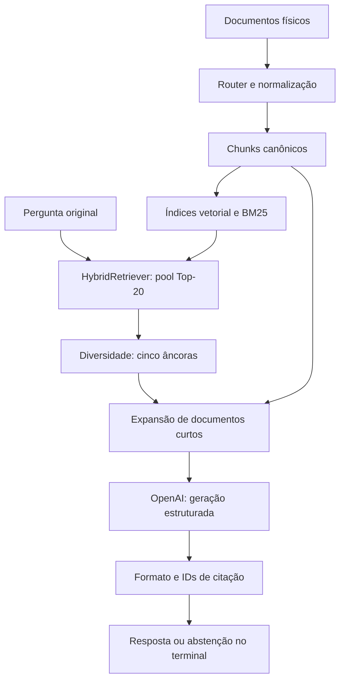

Arquitetura e contratos atuais — checkpoint RV-016
Status: revisão do código entregue, antes da orquestração proposta.
Data: 06/11/2026, America/Sao_Paulo.
1. Base e limites da revisão
Revisão da cópia de desenvolvimento do assistente, baseada em 055b0a8 e nos
incrementos RV-014/015/016 entregues nesta conversa. Não é inspeção do disco
Windows do usuário. O SHA definitivo do checkpoint será o commit local feito
por Rodrigo. Nenhum commit/push remoto integra esta revisão.

Evidências inspecionadas: código de app/, contratos de ingestão e registro,
arquitetura 01, JSONs RV-014 local, RV-016 diagnóstico, após expansão e comparação
GPT-4.1. A comparação mini entre prompts foi recebida como saída de terminal;
seu JSON ainda não foi inspecionado. Não atribuir a ele hashes não verificados.

Última suíte completa Windows informada: 576 passed / 4 warnings / 72,63 s,
antes de RV-015/016. Rodrigo informou posteriormente 44 testes RV-015 aprovados.
Os resultados de API demonstram execução real, não aprovação semântica.
Contagem esperada atual, se todos os incrementos estiverem presentes: 646 testes
(576 + 44 + 19 + 7). Confirmar no Windows; não tratar previsão como execução.

Regressão desta revisão no ambiente do assistente: 557 passed em 2,60 s.
Foram excluídos oito arquivos dependentes de Docling/integração de ingestão,
indisponíveis nesse ambiente. Este resultado não substitui a suíte completa local.
2. Fluxo realmente utilizado
ask_knowledge.main descobre dez documentos físicos por nome DOC-numero_nome,
executa parsing e chunking, cria embeddings e índices em memória; depois aceita
perguntas independentes. A indexação se repete ao iniciar um novo processo.

Não há classificação de intenção, decisão intermediária de suficiência,
recuperação complementar, revisão semântica ou reparo automático nesse fluxo.
Reranker está implementado e experimentado, mas não é usado pelo build_service.
3. Contratos e responsabilidades
Componente / arquivo	Entrada e saída	Garantia existente	Limite atual
IngestionRouter, ingestion/ingestion_router.py	Path → NormalizedContent	Roteamento por formato e tipo canônico	Não aplica registro/ACL no fluxo da CLI
DocumentRegistry, ingestion/registry.py	YAML → DocumentMetadata	IDs, formatos, estados e relacionamentos de versão validados	Não é consultado por load_chunks/build_service
CanonicalDocument, ingestion/schemas.py	Conteúdo + metadados controlados	Modelo de documento com versão, vigência, autoridade	CLI usa NormalizedContent diretamente
StructureAwareChunker	Conteúdo + caminho + doc_id → chunks	Estrutura, limites e origem	Não leva governança tipada para cada chunk
RetrievalChunk, chunking/schemas.py	ID, texto, ordem, blocos, localização	Identidade e proveniência estrutural	ID baseado em doc/ordem não identifica revisão de conteúdo
VectorIndexer / VectorRetriever	Chunks/pergunta → embeddings/ranking	Busca vetorial em evidência canônica	Índice sem persistência e sem ACL
BM25 / FilteredLexicalRetriever	Texto/pergunta → ranking lexical	Filtro PT/EN de palavras funcionais	Não traduz português para corpus inglês
ReciprocalRankFusion	Rankings → FusedCandidate	Identidade consistente, score RRF e métodos	Score não é probabilidade de suporte
DocumentDiversifier	Pool → âncoras	Diversidade e líder preservados	Diversidade documental não garante passagem adequada
EvidenceContextBuilder	Âncoras/pool → EvidenceContext	RV-014: preserva âncoras, um extra por documento	Pode incluir cabeçalho/objetivo e perder regras
ShortDocumentContextBuilder	Catálogo + âncoras/pool → contexto	Expansão atômica de documentos curtos	Mais ruído, custo e prioridade dependente da ordem das âncoras
OpenAIAnswerProvider	Pergunta/contexto → GenerationResult	Schema, checks de status/refusal, usage	Saída semanticamente incorreta pode obedecer ao schema
parse_answer / validate_answer	JSON/pergunta/contexto → StructuredAnswer	Campos, IDs, request_id, abstenção estrutural	Não prova sustentação, completude, escopo ou condições
RagService.ask	Pergunta → RagResult	Encadeamento e erro explícito	Fluxo fixo, sem revisão semântica
compare_saved_generation	Artefato salvo → duas gerações	Contexto fixo e prompts registrados	Um caso/amostra não constitui benchmark de generalização

O registro é metadado de controle, não evidência textual a ser indexada. A futura
integração não deve indexar gabaritos, canonical_facts ou golden_questions.
4. Invariantes e ambiguidades de contrato
- FusedCandidate.rank é rank de fusão; DocumentDiversifier renumera sua saída.
  O builder original resolve as âncoras pelo pool para recuperar a proveniência.
- EvidencePassage.source agora aceita FusedCandidate OU RetrievalChunk. Na
  expansão de documento, não há score/rank inventado. Consumidores não podem
  acessar .source.rank sem verificar o tipo. O replay RV-014 continua apenas
  com FusedCandidate, mas a união exige atenção em futuros consumidores.
- EvidenceContext.text é JSON renderizado com referências E1/E2 locais.
  request_id_for verifica renderização e calcula hash da pergunta+contexto.
  Isso detecta trocas acidentais, não autentica a resposta nem inclui modelo,
  prompt, configuração, usuário, corpus versionado ou política de acesso.
- StructuredAnswer: answered requer claims citados e motivo null; abstained
  requer claims vazios e motivo não vazio. Não existem estados partial,
  clarification_required ou error nesse contrato.
- Dataclasses construídos diretamente não fazem a validação completa. A
  fronteira de aceitação é parse_answer/validate_answer, não o construtor.
- RagService padrão usa EvidenceContextBuilder; build_service injeta
  ShortDocumentContextBuilder. Configuração precisa ser explícita na evolução.
- Chunks preservam páginas/slides/planilhas e IDs de blocos. Versionamento,
  authority_level e effective_date existem no registro, não no contrato atual
  do contexto. Texto de cabeçalho não substitui controle tipado de governança.
5. Limites operacionais atuais
Item	Valor / comportamento
Pergunta	Até 4.000 caracteres
Pool / âncoras	20 / 5
RV-014 original	Dez chunks, 12.000 caracteres renderizados
CLI atual após correção	Até 60 chunks e 32.000 caracteres
Documento curto	Até 6.000 caracteres de texto somado
Documento longo	Âncoras e até um complemento por ranking
Geração	Até 2.000 tokens de saída
Cliente API	Timeout 60 s, zero retries; não equivale a deadline global
Persistência	Índices só em memória; JSON opcional com evidências
Modelo	CLI padrão gpt-4.1-mini; parametrizável

Limites por caracteres não são orçamento de tokens. Latência de pergunta exclui
indexação. Usage reportado cobre geração, não custo/tokenização dos embeddings.
Erros de API/contrato propagam e encerram a CLI; não viram abstenção. Um contexto
vazio evita chamada ao gerador, mas busca vetorial tende a retornar candidatos
mesmo para perguntas irrelevantes.
6. O que os experimentos demonstraram
1. RV-014: referências B 13/15 → 15/15, 25 seleções preservadas, usando mais
   contexto. Isso não validou respostas nem generalização independente.
2. Primeiro RV-016: DOC-005 só com cabeçalho e objetivo; faltavam regras.
3. Expansão: DOC-005 completo no contexto; 10 → 45 trechos; 7.222 → 31.545
   caracteres; total de tokens 2.075 → 7.302 em execuções observadas.
4. Mini e GPT-4.1 ainda misturaram processos/condições. Trocar prompt/modelo
   não resolveu o caso. Os resultados não identificam uma causa única universal.
5. A proposta de orquestração é hipótese arquitetural motivada por essas falhas,
   ainda não uma melhoria comprovada.
7. Riscos priorizados
Prioridade	Risco	Tratamento proposto
Alta	Referência válida com afirmação não sustentada	Revisão claim a claim + avaliação humana independente
Alta	Seleção de documento sem regra aplicável	Assessment de evidências e uma expansão/busca direcionada
Alta	Colapso de condições e escopo	QueryAssessment e suporte textual por decisão
Alta	Governança apenas descrita no texto	Integrar registro ao catálogo; não permitir ao LLM conceder acesso
Média	Expansão extensa como padrão	Mantê-la como controle experimental, não solução definitiva
Média	Identidade sem versão de corpus	Fingerprint do snapshot e ligação com cada decisão
Média	Comparação difícil por falta de traço de busca	Trace de pools, decisões, fontes, prompts e budget
Média	Reindexar a cada sessão	Cache versionado em incremento próprio, sem bloquear estudo
Média	BM25 sem tradução da pergunta	Medir recuperação multilíngue antes de introduzir reformulação

8. Checkpoint
O commit deve ser descrito como integração experimental e diagnóstico de geração,
não como RAG validado para produção. Incluir scripts, testes, documentação,
artefatos de validação e auditoria gerada localmente. Rever o diff antes de
commitar. Não publicar automaticamente. Documentos 03/04 são estudo; não implicam
que os contratos propostos já estejam implementados.