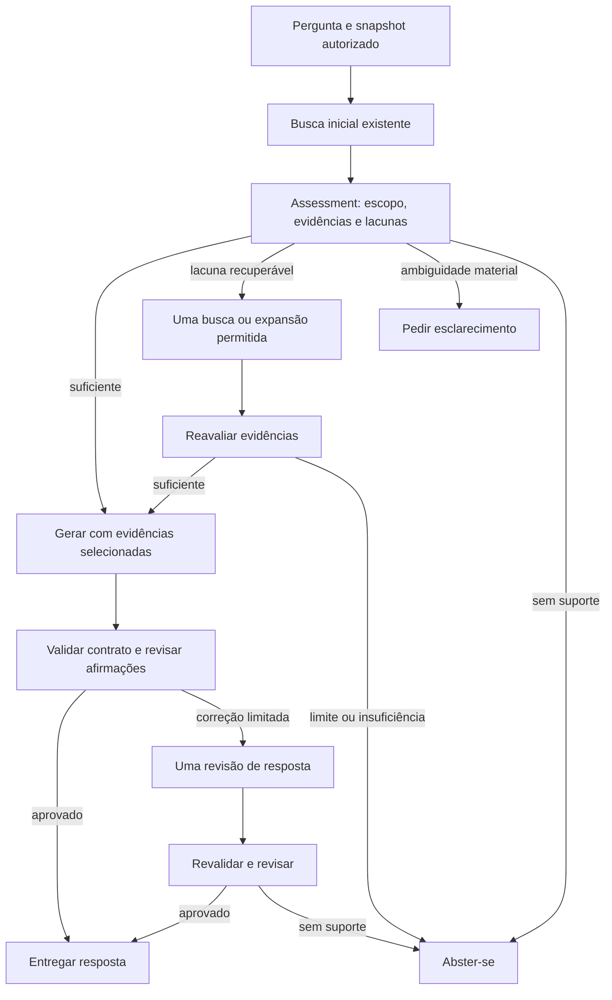

Proposta — Orquestração semântica com execução limitada
Status: proposta para revisão, não implementada.
Referência: [arquitetura atual](03_current_architecture_and_contracts.md).
1. Decisão estratégica
Adicionar um coordenador determinístico ao redor dos componentes existentes.
O LLM interpreta pergunta/evidências e propõe ações tipadas; o código decide
se pode executá-las, valida identidades e controla recursos. Não introduzir
framework de agentes, memória longa, múltiplos agentes autônomos nem banco
vetorial novo nesta etapa.

Objetivo verificável: reduzir respostas fora de escopo, condições omitidas e
abstenções por evidência não recuperada, com custo/latência medidos. Não prometer
que um segundo julgamento LLM garante correção ou independência.
2. Fluxo proposto
Para evitar uma chamada só de planejamento, começar pela busca original e
combinar interpretação da pergunta com avaliação inicial da evidência em uma
chamada. A análise retorna necessidades de evidência, não uma resposta antecipada.

Erros de provedor, dados inválidos e orçamento excedido encerram com estado
operacional próprio; não são disfarçados de falta de conhecimento. Esclarecimento
após reavaliação também é permitido se uma ambiguidade material for identificada.
Não há retorno ao retrieval depois da geração na primeira versão.
3. Quem controla o quê
LLM propõe	Código executa/impõe
Intenção, ação, entidades, direção, condições conhecidas/desconhecidas	Valida schema, tamanho, enums e vínculo com pergunta
Passagens aplicáveis, condicionais, insuficientes ou irrelevantes	IDs devem existir no snapshot autorizado
Lacuna e consulta/expansão complementar	Uma operação dentro da lista permitida e do budget
Suficiência para responder	Verifica evidência presente e requisitos formais; não confunde isso com prova semântica
Afirmações e referências	Contrato existente e resolução canônica das fontes
Suporte/contradição/omissão por claim	Exige IDs/excertos verificáveis, controla revisão e saída

Conteúdo de documentos é dado não confiável para instruções. Nenhum resultado
LLM pode redefinir permissões, limites, prompt de sistema, ferramentas, caminhos
arbitrários ou executáveis. Intenção do usuário não substitui ACL.
4. Contratos propostos (v1, nomes sujeitos à revisão)
Contrato	Campos essenciais	Invariantes
RequestEnvelope	run_id, schema_version, question, corpus_snapshot_id, access_scope_id, as_of	Separar identidade da execução do hash de evidência
QueryAssessment	intent, action, sender, recipient, subject, known_conditions, unknown_conditions, evidence_requirements	Não inferir condição desconhecida como fato; permitir null
EvidenceAssessment	question_hash, evidence_set_hash, assessments por chunk, decision, gaps, optional lookup	Avalia cada chunk apresentado; IDs únicos e do snapshot
EvidenceDecision	chunk_id, applicability, requirement_ids, supporting_spans, short_reason	Enum direct/conditional/background/irrelevant; spans são offsets exatos no texto original
LookupRequest	kind, query OU document_id/section_ids, gap_ids	search OU expand_document_section; uma operação; sem path livre
EvidenceBundle	snapshot_id, selected_chunk_ids, conditions_to_preserve, unresolved_gaps	Texto vem do catálogo, não de resumo fabricado pelo assessor
AnswerReview	answer_hash, context_hash, claim_reviews, missing_requirements, decision	Revisão por índice/hash do claim; source spans devem pertencer às citações
InteractionOutcome	status, answer OU clarification OU error, trace_ref	answered/abstained/clarification_required/error/budget_exceeded; payloads exclusivos
ExecutionTrace	etapas, ações, hashes, modelos, prompts, tokens, tempos, budget	Registrar decisões curtas, não raciocínio privado

Reutilizar StructuredAnswer dentro de InteractionOutcome para answered/abstained.
Não adicionar estados ao schema atual silenciosamente. Manter schema_version e
adaptadores de leitura para resultados antigos. AnswerReview não altera claims;
o coordenador pode chamar revisão e deve validar a nova resposta do início.

Contexto E1/E2 é criado apenas após seleção final. Assessments e buscas usam
chunk_id global + snapshot. Qualquer mudança de bundle gera novo context_hash e
request_id. Revisão é vinculada ao hash da resposta exata: não reutilizar review
de uma resposta anterior, mesmo que cite os mesmos IDs.

Offsets/excertos provam existência no texto, não aplicabilidade ou entailment.
Não usar score/confidence autorreportado como autorização automática.
5. Política de suficiência, esclarecimento e abstenção
- Quando a pergunta solicita requisitos gerais e a classificação não está
  especificada, responder por categorias se as evidências as cobrirem. Não
  pedir uma classificação só para evitar uma resposta geral possível.
- Se o usuário pede autorização concreta e falta uma informação que muda a
  decisão, solicitar esclarecimento sobre essa informação.
- Se falta trecho e o catálogo tem seção candidata, solicitar uma expansão
  direcionada. Não enviar documento inteiro por padrão.
- Se a evidência não existe após a tentativa permitida, abster-se com lacuna
  identificada. Não inventar ausência no corpus inteiro quando apenas a busca
  limitada falhou: explicar a insuficiência das evidências disponíveis.
- Evidências contraditórias não resolvidas não viram resposta assertiva.
- Não suportar resposta parcial no primeiro incremento; se necessária, projetar
  explicitamente status, questões não respondidas e critérios de avaliação.
6. Ferramentas internas e registro
Reutilizar VectorRetriever, BM25, RRF, diversificador e catálogo de chunks.
Expor apenas duas operações internas:
1. search(query, filtros autorizados, profundidade limitada);
2. expand_document_section(document_id, section_ids, limite de trechos).
O assessor recebe um catálogo resumido de seções dos documentos candidatos,
com identidade e metadados controlados, para poder solicitar a seção correta
sem adivinhar nomes. A expansão recupera todos os blocos necessários da seção,
incluindo tabela associada; não somente o título. Validar seção/documento no
snapshot. Documentos fora do conjunto inicial só podem entrar via busca autorizada.

Integrar DocumentRegistry por document_id; preservar versão, status, effective_date,
authority_level e relações de substituição como metadados tipados. Não codificar
precedência apenas pelo número de autoridade sem uma política explícita sobre
escopo, vigência e conflitos. Datas não substituem análise de aplicabilidade.

Primeiro protótipo usa corpus sintético sem autorização multiusuário. A interface
access_scope_id reserva a fronteira; ela só significa ACL real após implementação
e testes. Se metadado exigido estiver ausente, retornar erro/limitação explícita.
7. Limites de execução propostos
Recurso	Limite estrutural inicial
Buscas/expansões	Busca inicial + uma operação complementar
Assessments	Um inicial + no máximo uma reavaliação
Geração	Uma resposta + no máximo um reparo
Revisão semântica	Uma inicial + uma após reparo
Chamadas LLM	Caminho normal: 3; máximo: 6
Retries	Zero automáticos inicialmente; registrar falha
Reinício por esclarecimento	Nova requisição ligada à anterior; sem loop automático

Fixar limites cumulativos de input/output tokens e deadline antes do piloto;
não apenas por chamada. Contar com tokenizer compatível com modelo, reservar
saída e próxima etapa antes de iniciar cada chamada. Cancelar se o restante do
budget não permitir revisão obrigatória. Não entregar resposta não revisada
porque o orçamento acabou. Registrar consumo real e estimado separadamente.

Os valores numéricos de tokens/deadline devem ser escolhidos com dados do piloto;
32.000 caracteres não é um budget de tokens aprovado. Não ativar novo fluxo sem
esses limites definidos na configuração. Cada rodada paga precisa de orçamento
previsível; o estudo não autoriza chamadas automáticas neste ambiente.
8. Alternativas consideradas
Opção	Vantagem	Custo/limite	Decisão proposta
Aumentar contexto sempre	Implementação simples	Ruído/custo; não resolveu o exemplo	Manter como controle, não alvo
Modelo maior como única mudança	Pouca alteração de código	Não resolveu o exemplo observado	Não promover com essa evidência
Apenas prompt mais detalhado	Baixo esforço	Sem ganho observado no caso	Manter referência
Só reranking	Melhora ordenação potencialmente	Não avalia suficiência e mostrou regressão anterior	Experimento independente
Workflow limitado	Decisões rastreáveis e recuperação corretiva	Mais chamadas; novos modos de falha	Proposta escolhida para piloto
Agentes autônomos múltiplos	Flexibilidade	Custos/loops e debugging maiores	Fora do escopo inicial

9. Migração em duas entregas funcionais
Entrega 1 — seleção e recuperação orientadas por assessment
Introduzir contratos e coordinator em app/orchestration, adaptar catálogo/registro
e expor busca/expansão limitada. Reutilizar provider via adapter de JSON tipado,
sem duplicar autenticação e telemetria. Incluir geração no fluxo e execução em
modo de avaliação; não apresentar saída como semanticamente aprovada sem etapa 2.
Preservar --mode baseline para comparação e rollback, sem alterar o baseline.
Entrega 2 — revisão, uma correção e saída controlada
Adicionar review de claims, transições terminais, budget cumulativo e outcome
com esclarecimento/erros. Conectar CLI ao mesmo serviço que futura API/UI usará.
Só então considerar novo fluxo como candidato a padrão.

São entregas funcionais, não uma série de RVs por função. Módulos sugeridos:
contracts.py, coordinator.py, semantic_steps.py e adapters de ferramentas;
quantidade final deve seguir coesão, não um arquivo por dataclass.
10. Avaliação e critérios de aceitação
Congelar um conjunto pequeno de perguntas novas ANTES de ajustar prompts.
Separar desenvolvimento do caso conhecido de validação de generalização.
Incluir: pergunta direta, classificação não especificada, uso de IA explícito,
incidente ocorrido, conflito documental, ausência de evidência, ambiguidade
material, tabela e instruções maliciosas em documento. Não fornecer expected
answers ao assessor/gerador. O caso DOC-005 é regressão conhecida, não holdout.

Comparar baseline fixo e workflow no mesmo snapshot e modelo. Medir:
- correção/relevância, condições preservadas e cobertura dos requisitos;
- suporte de cada claim e citações corretas (revisão humana como referência);
- abstenção correta versus abstenção indevida e esclarecimentos necessários;
- eficácia da segunda busca: evidência nova relevante, não apenas mais texto;
- tokens totais de TODAS as etapas, chamadas e latência ponta a ponta;
- falhas operacionais, violações de orçamento e falsos PASS do verificador.
Gate proposto: nenhum erro crítico de autorização/condição nos casos revisados;
nenhuma regressão conhecida sem decisão explícita; limites sempre respeitados;
melhoria observável de qualidade que justifique o custo. Tamanho pequeno não
permite declarar confiabilidade de produção. Rodadas repetidas em casos críticos
são necessárias antes de alegar estabilidade.

Testar máquina de estados, ID/offset inválido, revisão de versão errada, chamada
extra bloqueada, timeout, orçamento insuficiente, erro sem abstenção falsa e
preservação das evidências. Evitar dezenas de testes que apenas espelham campos.
11. Decisões pendentes antes da implementação
1. Confirmar checkpoint local e sua suíte completa.
2. Aprovar a estratégia limitada e a preservação do baseline.
3. Definir modelos por etapa e budgets numéricos do piloto; não pressupor que
   o mesmo modelo que falhou na geração será juiz confiável.
4. Congelar os casos e a rubrica de avaliação, com custo máximo por rodada.
5. Definir política de metadados/precedência para o corpus sintético sem prometer ACL.
A proposta complementa a arquitetura 01: torna explícitos processamento de
consulta, avaliação de evidência e validação semântica já desejados, sem descartar
a ingestão/retrieval construídos. Não inclui migração de produção, UI, deploy ou
publicação automática.