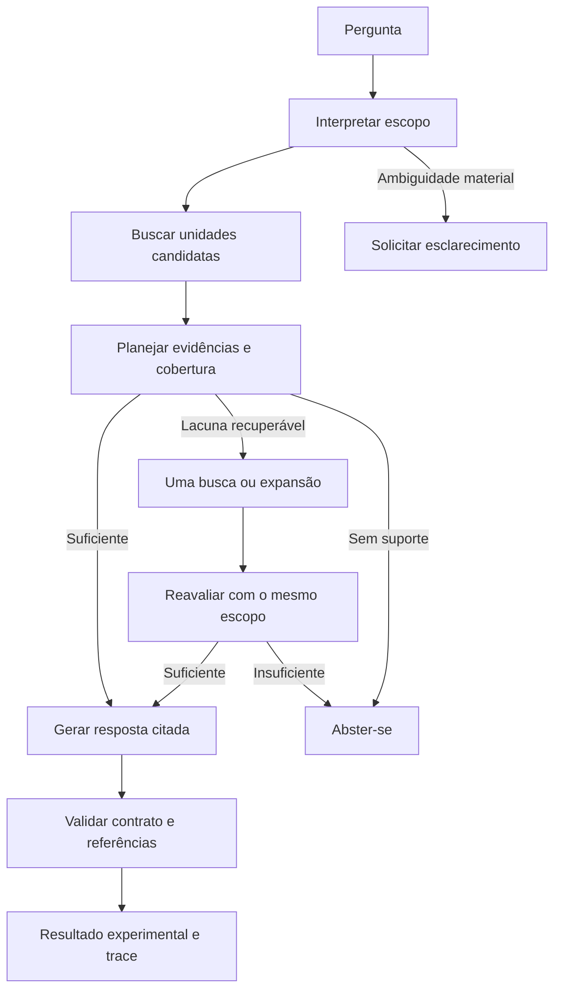

Desenho da revisão orientada a evidências
Status: desenho para implementação experimental; runtime ainda não alterado.
Base: arquitetura e contratos examinados, snapshot de 79 chunks e diagnósticos
06–08, incluindo a análise das oito gerações de contexto mínimo/amplo.
Este documento define a próxima revisão; não registra uma solução já validada.
1. Resultado que queremos produzir
Responder à pergunta empresarial com as regras pertinentes, preservando suas
condições, papéis e fontes. Encontrar o documento correto, produzir JSON válido
ou citar um trecho existente são verificações necessárias, mas insuficientes.

O fluxo deve distinguir três problemas: evidência não encontrada; evidência
encontrada mas não selecionada; evidência entregue mas mal utilizada na resposta.
Essa distinção precisa aparecer no mesmo relatório de execução.

Decisões principais:
1. Interpretar o pedido antes de apresentar documentos ao LLM.
2. Preservar conteúdo canônico e derivar representações diferentes para busca e leitura.
3. Selecionar por aplicabilidade e cobertura; diversidade documental será secundária.
4. Entregar ao gerador um plano de cobertura acompanhado de evidência verificável.
5. Manter execução limitada, baseline e revisão semântica de avaliação explícitos.
Este desenho substitui, para a próxima entrega, a escolha do documento 04 de
combinar interpretação da pergunta e assessment inicial. Também adia seu revisor
automático com reparo. A separação proposta é uma hipótese de melhoria a validar;
uma chamada adicional não garante melhor compreensão.
2. Arquitetura: preparação e consulta
Preparação ocorre quando fontes ou representações mudam, não a cada pergunta.
Fontes físicas → parsers existentes → conteúdo canônico → catálogo de unidades
e projeções → índices. Índices e catálogo são vinculados a um snapshot versionado.

Esclarecimento também pode ser necessário após examinar as fontes. Erros de
contrato, provedor e orçamento têm estados próprios em qualquer etapa; não são
abstenções por falta de conhecimento. Nenhum caminho retorna à busca após geração.
O resultado experimental não recebe selo de aprovação semântica automática.
3. Representação: fonte, unidade e projeção
Preservar CanonicalDocument, blocos, células, tipos e localizadores. Não usar
resumos produzidos pelo LLM como substitutos das fontes. Não reconstruir tabelas
de XLSX a partir do texto achatado dos chunks antigos: a nova preparação utiliza
os blocos normalizados e persiste sua estrutura no novo snapshot.

Uma EvidenceUnit é um agrupamento estrutural rastreável, não uma declaração
de que o conteúdo seja uma regra aplicável. Pode representar uma seção curta,
parágrafo, tabela, registro tabular ou fragmento com dependências.
Representação	Finalidade	Conteúdo
Canônica	Auditoria e reconstrução	Blocos e células originais normalizados, com localização
Unidade de evidência	Identidade e relações	Referências à fonte, papel estrutural, pai e dependências
Texto de busca	Localização	Identidade/título documental, seção, cabeçalhos e conteúdo
Texto de leitura	Compreensão e citação	Conteúdo fiel, cabeçalhos próximos dos valores e condições necessárias

Regras de construção:
- Associar título, introdução e tabela da mesma seção quando a estrutura permitir.
  Não separar obrigatoriamente por diferença entre tipo texto e tabela.
- Títulos podem orientar busca e expansão; um título sozinho não satisfaz uma
  necessidade de conteúdo operacional. Metadados estruturais não serão inferidos
  como categorias normativas por palavras-chave.
- Tabelas pequenas de categorias permanecem legíveis como conjunto. Para pergunta
  geral, recuperar uma linha não basta para excluir as demais classes pertinentes.
- Matrizes de decisões admitem unidades por registro, repetindo rótulos das colunas
  e mantendo ligação à tabela, cabeçalhos, notas e condições comuns.
- Cabeçalhos de XLSX só são associados quando a estrutura for inequívoca e validada:
  região retangular, cabeçalhos identificáveis e correspondência de colunas.
  Não assumir universalmente que a primeira linha seja cabeçalho. Na ambiguidade,
  preservar a região e sinalizar unresolved_structure; não inventar relações.
- Preservar valores e fórmulas separadamente. A projeção não executa fórmulas nem
  apresenta valor ausente como resultado calculado.
- Fragmentos grandes respeitam parágrafos/linhas e carregam cabeçalhos/dependências
  necessários. Se uma unidade indivisível exceder o limite, registrar excesso e
  encerrar esse caminho explicitamente; não cortar silenciosamente uma condição.
Exemplo estrutural da matriz, sem tradução ou inferência na projeção:
Required Approval [C9]: Information Security Owner + AI Governance Owner
Additional Review [D9]: Data Owner
Notes [E9]: Tool and use case must be approved for the data classification.
Cabeçalhos também recebem referências às respectivas células de origem. Não basta
referenciar C9 para afirmar que seu valor representa uma aprovação. Na geração,
“Additional Review” não pode virar aprovação e a conjunção de E9 deve ser preservada.

O ganho dessa representação ainda precisa ser medido. O diagnóstico mostrou
confusão de papéis, mas não provou que a apresentação fosse sua única causa.
4. Escopo: o que foi perguntado
Uma chamada curta interpreta somente a pergunta, sem candidatos, gabaritos ou
respostas esperadas. Produz tipo de pedido, ação, entidades, direção do fluxo,
referências documentais, exclusões explícitas e condições conhecidas/desconhecidas.
Afirmações sobre o usuário precisam de suporte na própria pergunta; interpretação
e informação explicitamente declarada ficam diferenciadas.

O escopo é congelado antes da busca. O planejador pode descobrir categorias e
requisitos nas fontes dentro dele, mas não acrescentar outro processo ao pedido.
Inconsistência material exige esclarecimento ou encerramento, não reescrita oculta.

Exemplos de comportamento, não regras especiais por ID:
- Cuidados gerais de compartilhamento: responder por classes quando pertinente;
  não presumir confidencialidade e não pedir classe para evitar resposta geral.
- Consulta restrita a uma política: buscar dentro dela. Complemento externo só
  quando a pergunta permitir ou a política remeter a ele; identificar essa origem.
- Autorização para uma ação concreta: perguntar pelo dado ausente que muda a decisão.
  A aplicação explica requisitos; não concede aprovação corporativa.
- Incidente já ocorrido: tratar contenção e reporte, sem converter em pedido prévio.
5. Busca e planejamento de evidências
Manter inicialmente embeddings, BM25 e fusão existentes. Unificar o envelope
documental usado pelos canais de busca. Resolver referência explícita a documento
no catálogo antes do ranking; um ID desconhecido não dispara consulta genérica
silenciosa. Busca vetorial continua relevante para pergunta PT e fonte EN.

Registrar contribuição de cada canal. Tradução lexical automática permanece uma
experiência separada: não atribuir à nova representação um ganho vindo de tradução.
Remover do caminho candidato a obrigação de preencher cinco documentos distintos.

O planejador recebe escopo congelado, candidatos e catálogo limitado de relações.
Propõe itens de cobertura com unidades/excertos que os sustentam e uma disposição:
Disposição	Tratamento
Aplicável ao pedido	Incluir com suas condições
Categoria dentro do pedido geral	Incluir como categoria, sem afirmar que ocorre no caso do usuário
Condição material desconhecida em decisão concreta	Solicitar esclarecimento
Outro processo ou exclusão explícita	Não transformar em obrigação da resposta
Navegação estrutural	Usar para localizar conteúdo; não contar como cobertura

Os itens de cobertura nascem da pergunta e das fontes disponíveis, não do golden set.
Devem apontar evidência, condição relevante e forma de uso. Uma remissão a outra
política pode justificar complemento, mas não amplia automaticamente o escopo.

Seleção final materializa as unidades propostas e suas dependências. Prioridade:
escopo → evidência dos itens materiais → condições/cabeçalhos necessários → remoção
de duplicatas → diversidade entre evidências igualmente úteis. Se não couber tudo,
não declarar suficiência mantendo uma cobertura que foi descartada pelo orçamento.

Permitir uma operação complementar: expansão estrutural identificada OU busca
para uma lacuna descrita. O código resolve os alvos e impõe limites; reavaliação
usa o mesmo escopo. Insuficiência restante termina em abstenção ou esclarecimento.
6. Contratos e responsabilidade de cada camada
Nomes abaixo descrevem contratos propostos; não são classes já implementadas.
Uma classe por arquivo não é requisito. Usar módulos por responsabilidade.
Contrato	Campos essenciais	Responsabilidade e invariantes
SourceRef	documento/revisão, bloco, localização, célula ou intervalo textual	Código valida existência; offsets são calculados no texto de origem, nunca adivinhados pelo LLM
EvidenceUnit	unit_id, representation_version, source_refs, structural_role, parent_id, dependency_ids	Construção determinística; grafo sem ciclos e sem fontes inventadas
QueryScope	tipo, ação, participantes, referências, exclusões, condições, apoio na pergunta	LLM interpreta; código valida e congela hash; escopo não contém resposta antecipada
CandidateSet	snapshot_id, scope_hash, unidades, scores/ranks por canal, relações	Código gera; IDs e limites conferidos antes do planejamento
EvidencePlan	itens de cobertura, seleções, condições, lacunas, próxima ação	LLM propõe; referências resolvidas pelo código; ação é uma alternativa exclusiva
EvidenceBundle	scope_hash, plan_hash, unidades materializadas, itens de cobertura, mapa de citações	Código renderiza; nenhum texto inventado pelo planejador vira fonte
AnswerEnvelope v2	bindings, status, claims com citações e vínculos aos itens de cobertura	Provedor produz conteúdo; aplicação liga identidades e valida referências
RunTrace	versões/hashes, etapas, seleção, exclusões, falhas, uso e tempos	Aplicação registra decisões curtas; não solicitar raciocínio privado

Simplificação do protocolo do assessor:
- O LLM não copia hashes, cria IDs globais ou calcula offsets. A aplicação faz isso.
- O plano traz apenas seleções e lacunas; não exige que o modelo reproduza uma
  decisão para cada candidato. Itens não escolhidos ficam registrados como
  not_selected, sem inventar uma justificativa semântica para eles.
- Itens de cobertura recebem IDs pelo código após validação do plano. Suportes
  ficam aninhados em cada item, evitando referências R9/R10 inexistentes.
- Operações têm payload exclusivo: finalizar, esclarecer, abster, buscar ou expandir.
  Schema específico e validação local; JSON inválido não ganha reparo automático.
- Excertos precisam corresponder à fonte/projeção identificada. Se houver múltiplas
  ocorrências e faltar localização inequívoca, rejeitar; não aplicar fuzzy matching.
O request_id_for atual só vincula pergunta e contexto. O v2 deve incluir também
escopo, plano, versão de representação e mapa de citações: trocar condições ou plano
com o mesmo texto de contexto não pode reaproveitar a identidade da resposta.
7. Geração e limites da validação
O gerador recebe pergunta, escopo, plano de cobertura e bundle fiel. Não recebe
gabarito. Deve cobrir os itens pertinentes sem acrescentar cenários; preservar
ator, ação, condição, modalidade, negação, conjunção e exceção.

Claims relacionam-se aos itens de cobertura e às citações. O código verifica IDs,
presença formal de cobertura e integridade das fontes. Uma claim referenciar todos
os itens não prova que seu texto os explique: completude e sustentação continuam
exigindo avaliação semântica. Não denominar esse gate grounded ou semantic_pass.

Reutilizar a semântica de answered e abstained. O envelope externo mantém
clarification_required, error e budget_exceeded. Não introduzir resposta
parcial sem contrato específico; insuficiência material impede uma resposta completa.
Não adicionar revisor LLM, retries de prompt ou reparo nesta entrega.

Documentos são evidências, não instruções ao sistema. O planejador não executa
comandos, decide permissões ou altera limites. Registro/vigência acompanham fontes;
conflito material sem política de resolução explícita bloqueia conclusão assertiva.
Este piloto permanece sem ACL multiusuário e não constitui liberação para produção.
8. Orçamento, cache e observabilidade
Caminho normal: três chamadas LLM — escopo, plano, geração. Caminho com complemento:
no máximo quatro, pela reavaliação do plano. Clarificação/abstenção podem encerrar
antes. Busca inicial e eventual busca complementar podem demandar embeddings de
consulta: até duas chamadas adicionais, separadas das quatro LLM. Expansão por
catálogo não exige embeddings. Indexação é orçamento separado de preparação.

Configuração obrigatória antes de executar: modelo por etapa, limites de saída,
entrada acumulada, custo estimado máximo, prazo, quantidade de unidades e tamanho
renderizado. Reservar recursos para as etapas restantes antes de iniciar cada chamada.
Estimativa de tokens não é garantia de cobrança; manter estimado e observado separados.
Preflight informa plano e orçamento; execução paga continua explícita no runner.

Cache de embeddings depende do texto exato, modelo e configuração; índice depende
também do conjunto/versionamento das unidades. Nunca reaproveitar vetor para texto
alterado. Pools só são reutilizados com consulta, filtros, snapshot e configuração
equivalentes. Não cachear respostas entre escopos diferentes.

Um trace por pergunta reúne: escopo, pool por canal, unidades selecionadas, expansão,
cobertura, contexto exato, resposta, contratos, tokens, custo estimado e latência.
Ausência de um sinal fica como não observado, não score zero fabricado. Erros operacionais
devem identificar etapa e código seguro; segredos não entram no relatório.
9. Migração e sequência de implementação
Preservar baseline e snapshots antigos. O snapshot v2 inclui estrutura normalizada,
unidades/projeções e configurações/hash de construtores. Um snapshot antigo apenas
com chunks não é promovido artificialmente a uma estrutura que ele não contém.
IDs novos se vinculam à revisão da fonte, localizador e versão de representação;
comparações usam documento/bloco/célula, não igualdade do ordinal de chunks.

Três incrementos internos formam uma única entrega funcional:
Ordem	Mudança	Evidência de conclusão
1	Catálogo/projeções, snapshot v2 e índice rastreável	Relações tabulares e dependências preservadas; representação reproduzível
2	Escopo separado, plano simplificado e seleção limitada	Caminho completo até bundle, sem diversidade obrigatória nem expansão indiscriminada
3	Geração vinculada ao plano, runner comparativo e documentação	Resposta e trace ponta a ponta; critérios semânticos avaliados

Concentrar contratos/coordenador em app/orchestration, projeções em app/chunking
e integração com busca/geração nas interfaces existentes. CLI continua adaptador do
serviço. Criar contrato v2 explícito onde necessário, sem mudar silenciosamente a
interpretação de RetrievalChunk, EvidenceContext ou resultados históricos.

Manter testes de invariantes com exemplos reais de tabelas/texto e testes de fluxo
para falhas/transições. Evitar uma nova campanha de validação para cada função.
Nenhum incremento vira padrão antes da avaliação integrada. Rollback usa baseline
e seu próprio snapshot/índice, sem misturar evidências das duas representações.
10. Avaliação da entrega e critérios de aceitação
Congelar perguntas, rubrica, configurações e limites antes da rodada. Separar:
integridade de representação; cobertura do pool; cobertura selecionada; qualidade
da resposta. Métricas documentais antigas permanecem, identificadas como documentais.
Caso de desenvolvimento	Aceitação material
ORC-001, compartilhamento geral	Classes pertinentes e controles corretos; nenhuma obrigação de IA imposta
ORC-002, política explícita	Regras operacionais da política, incluindo categorias/condições; exclusão de IA respeitada
ORC-003, uso confidencial em IA	Aprovação distinta de revisão; ferramenta E uso aprovados; nenhuma autoridade inventada
ORC-004, incidente	Reporte, preservação e ações materiais de contenção/orientação sem regressão

Mapa de regras materiais e fontes deve ser fechado a partir da rubrica diagnóstica
antes da execução, não reescrito para acomodar a resposta. Ele fica exclusivamente
na avaliação. Os seis casos reservados só são executados após congelar o candidato;
não constituem holdout cego independente. Falha neles exige nova revisão/versionamento,
não ajuste silencioso seguido de declaração de validação independente.

Uma campanha, com braços rotulados: baseline; representação nova com seleção legada
adaptada; fluxo completo. O braço intermediário é diagnóstico, não candidato a padrão.
Usar mesmas fontes e modelo de geração. Mudança de IDs/unidades impede comparação
ingênua por número de chunk. Quando possível, compartilhar pools/embeddings válidos.
Reutilizar saídas salvas apenas se toda a configuração relevante corresponder.

Primeiro verificar representação/seleção sem geração paga. Depois executar os quatro
casos; repetir três vezes os casos críticos ORC-001 e ORC-003 no candidato congelado
para observar instabilidade. Reportar cada resultado, não só a melhor resposta.
Se houver erro material, interromper promoção; repetições não apagam uma falha.

Gate da entrega: zero obrigação/autoridade inventada ou condição material perdida
nos casos revisados; cobertura material completa; nenhuma regressão não resolvida;
contratos e budgets respeitados. Medir abstenção/esclarecimento indevidos, ruído,
tokens e tempo de TODAS as etapas. O custo adicional deve ser explicitado ao decidir
adoção; não prometer economia só porque o contexto do gerador diminuiu.

Se o candidato falhar, o trace determina o alvo: evidência ausente → busca/projeção;
presente e excluída → plano/seleção; entregue e distorcida → geração/fidelidade.
Só então comparar instrução/modelo sob evidência idêntica ou considerar revisão
automática. Não reiniciar uma sequência aberta de patches sem hipótese.
11. Limites deliberados desta revisão
Não trocar parser, banco vetorial ou framework; não ajustar globalmente tamanho de
chunks sem evidência; não introduzir tradução automática, agentes autônomos, revisão
recursiva, frontend ou permissões multiusuário. Esses itens não são pré-requisitos
para demonstrar a correção do fluxo atual.

O próximo trabalho é implementar o incremento 1 com os contratos deste desenho,
preservando o baseline. A conclusão da entrega depende dos três incrementos e da
avaliação conjunta, não da contagem de testes unitários aprovados.

Referências internas: [diagnóstico integrado](06_root_cause_investigation_and_plan.md),
[evidência do corpus](07_corpus_evidence_diagnosis.md),
[chunking](08_chunking_engineering_diagnosis.md),
[experimento de contextos](../validation/CONTEXT_DIAGNOSTIC_ANALYSIS.md).