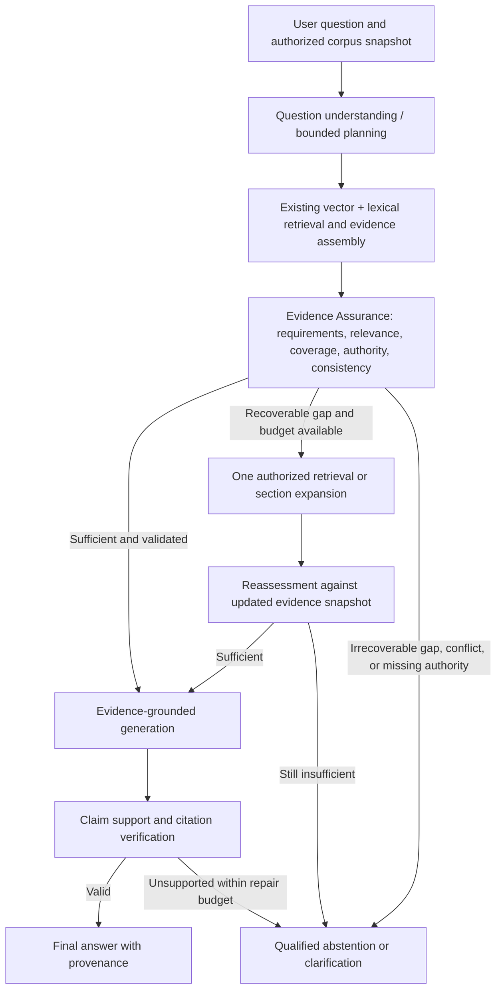

# Evidence Assurance — Post-Orchestration Architecture Proposal

**Project:** Enterprise Knowledge AI System
**Date:** 2026-11-10
**Status:** Architecture proposal / not implemented or promoted
**Scope:** Controlled evaluation of evidence sufficiency after bounded retrieval orchestration and before grounded generation.

## 1. Motivation and experimental evidence

The project currently has a conventional RAG terminal path and separately developed, experimentally evaluated orchestration/evidence-pipeline components. These paths must not be represented as one fully integrated production workflow.

The synthetic controlled corpus contains 27 documents and 158 retrieval chunks. In RV-034D, 81 selected deterministic canonical-alignment checks passed, with five review flags concerning synthetic contract mechanics or proposed committee actions. The checks do not establish exhaustive semantic consistency.

RV-035 evaluated 35 positive-evidence questions from the 36-question Golden Set (Q29 requires abstention evaluation). The vector baseline recorded Recall@5 of **0.9310** and FullEvidence@5 of **0.8286**. The current hybrid retrieval configuration recorded **0.9071** and **0.7714**, respectively. RV-036 evaluated bilingual lexical expansion and bounded vector-prefix protection: the *protected-three* candidate reached Recall@5 **0.9500** and FullEvidence@5 **0.8571**. Baseline rank drift was recorded across Q12, Q13, and Q18; the reported aggregate comparison is experimental, not a promotion decision. These metrics are **document-level evidence retrieval** and do not prove claim support, authoritative applicability, or generated-answer correctness.

Examples of observed failure modes include lost historical policy evidence (Q28), incomplete multi-source incident/governance coverage (Q18, Q19), and gaps in approval-authority coverage (Q34). Fixed Top-K selection alone is not a reliable evidence-sufficiency decision.

## 2. Architecture decision

Introduce a bounded **Evidence Assurance** stage after candidate retrieval/planning and before answer generation. The stage evaluates explicit evidence requirements and decides whether to accept the bundle, request **one authorized complementary retrieval or section expansion**, seek clarification where necessary, or abstain with a precise limitation.

This is a **proposal**, not proof of an implemented autonomous agent. Start with a deterministic coordinator plus optional schema-constrained LLM assessment; do not introduce an unconstrained multi-agent framework. Retain the ability to bypass the new stage for controlled baseline comparison and rollback.

## 3. Separation of responsibilities

| Component | Owns | Does not own |
|---|---|---|
| Retrieval layer | Candidate discovery, ranking, lexical/vector scoring, source provenance | Evidence sufficiency or legal/organizational authority decisions |
| Bounded orchestration | Query decomposition, controlled search/expansion, context composition | Unbounded retries or fabricated evidence |
| **Evidence Assurance** (proposed) | Required information, coverage gaps, applicability, temporal/authority checks, next authorized action | Source-of-truth creation, final enterprise decision, free-form tool execution |
| Generation | Statements derived from accepted evidence | Filling missing facts from model priors |
| Answer verification | Claim-by-claim citation support, unsupported inference, omitted qualifications | Retroactively treating absence of cited source as proof of enterprise nonexistence |
| Human owner | Approvals, exceptions, selection, policy changes | Delegating accountability to a model |

A valid citation identifier or an existing quoted span is **not** sufficient proof of semantic entailment. A high retrieval score is **not** authority.

## 4. Minimal typed contracts (proposal)

**EvidenceRequirement:** `requirement_id`, `question_scope`, `required_kind`, `entities`, `time_context`, `authority_constraints`, `mandatory`.

**EvidenceAssessment:** `snapshot_id`, `question_hash`, `evidence_set_hash`, `requirement_results`, `source_conflicts`, `decision`, `proposed_action`, `reason_codes`.

**RequirementResult:** `requirement_id`, `status` (`supported`, `partial`, `missing`, `conflicted`, `not_applicable`), `supporting_chunk_ids`, `missing_aspects`, `applicability_notes`.

**AssuranceDecision:** `APPROVE`, `RETRIEVE_MORE`, `CLARIFY`, `ABSTAIN`, `ERROR`, `BUDGET_EXCEEDED`. These are **new proposal-level types**, not silently added to existing `StructuredAnswer`.

**LookupRequest:** `kind` (`search` or `expand_document_section`), `query` or validated document/section IDs, `target_requirement_ids`, bounded `top_k`/size. Reject arbitrary filesystem paths and dynamic tool invocations.

**AssuranceTrace:** immutable references to input hashes, selected chunk IDs, requirement coverage, action reason codes, budget use, LLM/model version where applicable, and terminal decision; no private reasoning traces.

Evidence IDs must belong to the authorized immutable corpus snapshot. After any retrieval expansion, rebind `evidence_set_hash` and re-evaluate; generated citation IDs are assigned only after selection and must be validated again after answer generation.

## 5. Authority, provenance, and synthetic-corpus controls

1. Resolve `document_id` through the document registry for version, effective date, lifecycle state, scope, and authority before accepting normative claims. The registry and canonical facts are **control/evaluation metadata**, not RAG evidence to expose as source passages.
2. An active corporate policy may prevail over an obsolete SOP where relevant, but historical questions must still retain superseded records as historical evidence. Never select based only on a numeric authority level.
3. Treat proposed synthetic financial mechanics and committee actions (e.g., RV-034D review flags in DOC-014/015/016/019/020) as document claims with explicit qualification; the review flags require human resolution before asserting that such details are canonically approved.
4. For intentional unknown Q29, avoid hallucinating a radioactive-material policy. A failed Top-K search does not automatically prove that no such policy exists across all possible enterprise sources.
5. For carrier-selection Q30, provide supported criteria and defer the actual selection to authorized human decision makers.
6. Source text, including retrieved instructions, is untrusted data. It cannot change tool permissions, access scope, or evaluator policy.

## 6. Bounded execution policy

- Normal path: initial candidate retrieval, one assurance assessment, answer generation, and separate claim verification.
- Recovery path: at most **one** complementary search **or** explicit section expansion and one reassessment in the first pilot.
- Do not retry indefinitely; require explicit hard caps for cumulative API tokens, estimated cost, deadline, context bytes, and retrieved passages **before** production enablement.
- Fail closed on invalid schema, unknown chunk/source IDs, unauthorized access, or unresolved mandatory requirements. Return a distinct operational error rather than mislabeling infrastructure failure as insufficient knowledge.
- Optional LLM assessment can recommend actions but never execute them directly. The deterministic coordinator validates and invokes only the allowlisted operations.
- A separate post-generation answer verifier is required for semantic confidence; do not reuse its judgment as a substitute for evidence completeness.

## 7. Evaluation and acceptance gates

**Offline prerequisite:** complete RV-037 on recorded RV-036 candidate traces; distinguish regression per question from aggregate improvements, resolve baseline rank drift, and record stable retrieval snapshots.

**Pilot:** select historical, cross-document, authority and ambiguity cases (including Q18, Q19, Q24, Q27, Q28, Q30 and Q34) plus newly frozen holdout cases, including Q29 for abstention. Do not encode question IDs, expected document IDs or golden answers in runtime policy.

Evaluate the following independently:

- Document-level and chunk-level expected-evidence recall, document FullEvidence@5 and relevant span coverage.
- Requirement-level completeness: percentage of *required answer facets* supported by retrieved passages.
- Appropriateness of `RETRIEVE_MORE`, `APPROVE`, `CLARIFY`, `ABSTAIN`, including false-positive missing-evidence detection.
- Authority/version/temporal conflict handling and decision-boundary compliance.
- Claim-level support, condition preservation and citation precision **after generation**.
- Extra retrievals, added passages, cost, tokens, latency, provider failures and budget-exceeded outcomes.
- Regressions against vector-only and current hybrid baselines on the frozen corpus.

Promotion requires preregistered acceptance thresholds, reproducible source snapshots, no unreviewed high-risk regressions, and human inspection of borderline judgments. A higher aggregate Recall@5 alone does not authorize promotion.

## 8. Suggested implementation boundary (not created by this document)

Within existing `app/orchestration/`, reuse the current contracts, coordinator, snapshot and evidence pipeline instead of duplicating these functions. Introduce cohesive contract extensions and a dedicated assurance evaluator only after inspecting existing interfaces. Expose the coordinator to the same service used by the CLI and future API. Keep a selectable `baseline` path; do not silently change `build_service` or `ask_knowledge` defaults.

Recommended rollout: (a) deterministic requirements/authority assertions, (b) controlled recovery request, (c) bounded optional semantic assessment, (d) independent generation verification, (e) comparison against fixed test and holdout sets, and only then a production-candidate decision.

## 9. Status and references

- **Implemented / available:** document ingestion, structure-aware chunking, vector search, BM25, RRF, document diversity, structural citation contracts, and experimental bounded orchestration/evidence components.
- **Measured:** RV-034D (selected deterministic alignment), RV-035 (real embedding document retrieval), RV-036 (bilingual/protection candidate comparison).
- **Pending:** RV-037 offline selection audit, human closure of canonical review flags, full Golden Set semantic answer validation, integrated post-orchestration assurance, runtime authorization and production hardening.

Related design documents: `docs/architecture/03_current_architecture_and_contracts.md`, `docs/architecture/04_bounded_orchestration_proposal.md`, `docs/architecture/05_stage1_contracts_and_evaluation.md`. The README summarizes the project; this file is a proposed design record and **does not itself implement or validate** the stage.
