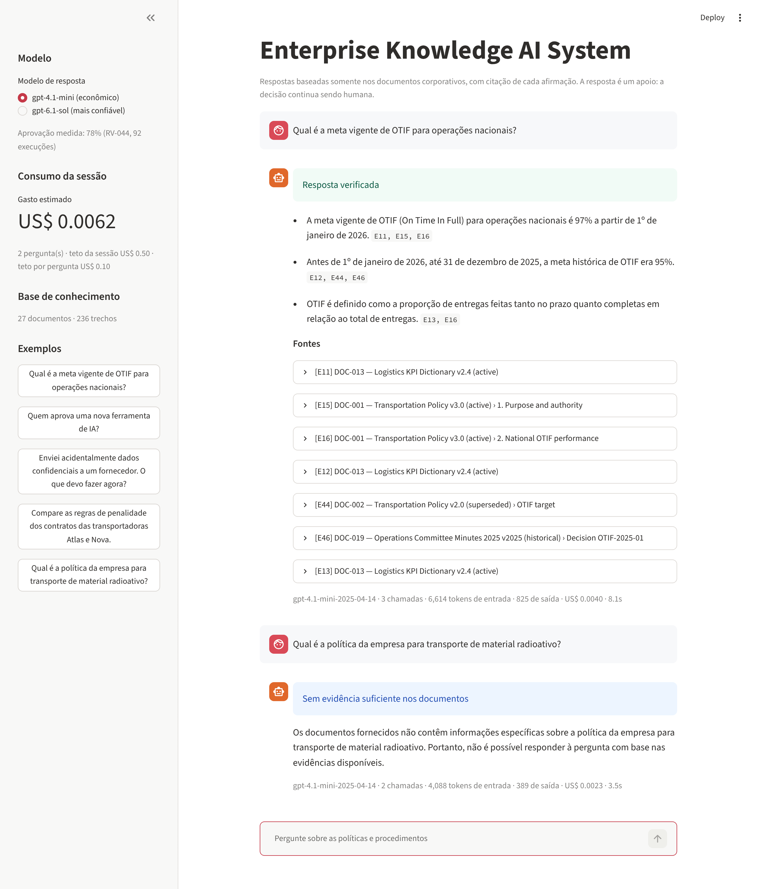

# RV-045 — Clean corpus and MVP interface

**Status:** functional MVP. The cleaned corpus and the reduced request shape have
been exercised end to end on two questions only; the 46-case evaluation has not
been repeated on them.

## Corpus

`app/scripts/rv045_clean_corpus.py` removed the evaluation-harness text found in
RV-044 from 26 documents. Business facts were not changed.

| Check | Before | After |
|---|---:|---:|
| Searchable passages with harness text (`audit_corpus_content`) | 67 of 244 | 0 of 219 |
| Documents affected | 26 of 27 | 0 of 27 |

- PDFs were regenerated with ReportLab from the structure parsed in RV-044. All 15
  were re-parsed with Docling and keep the same headings, paragraphs and tables.
- DOCX, PPTX, XLSX, Markdown and text files were edited in place.
- DOC-011 no longer states that it conflicts with DOC-006, and DOC-025 / DOC-027 no
  longer describe themselves as distractors. Authority and lifecycle now have to be
  resolved from document status, DOC-006 and DOC-007.
- The three carrier contracts no longer describe each other, so Q12 needs all three.
- DOC-013 lost its "Canonical status" column; metadata rows about the test were
  removed from DOC-012, DOC-013 and DOC-021.
- The script is a one-time migration. Its PDF output is byte-reproducible; Office
  files are not, so do not re-run it over the cleaned corpus. The pre-cleaning
  catalog is in commit `32022ce`.

The catalog (`EVIDENCE_UNITS_SNAPSHOT_27DOC.json`, 236 units, 219 searchable) and
its embeddings were rebuilt from the cleaned files. RV-035/036 retrieval figures
and RV-044 answer figures were measured on the previous text.

## Interface

```powershell
pip install -r requirements.txt
$env:OPENAI_API_KEY = "..."
streamlit run app/frontend/main.py
```

- `app/service/knowledge_service.py` loads the verified catalog once and answers
  through the lean pipeline. It is the single entry point for any future API.
- `config/lean_runtime.json` holds catalog paths, models, prices and cost ceilings
  (USD 0.10 per question, USD 0.50 per session). Prices must be checked against
  current billing.
- The interface shows the status, each claim with its citations, the cited
  passages, reservations, and tokens and cost per question and per session.

Measured in the interface with `gpt-4.1-mini`: an answered question used 6,614
input and 825 output tokens in 3 calls (USD 0.004); an abstention used 4,088 and
389 in 2 calls (USD 0.002).



## Still open

1. Repeat the 46-case evaluation on the cleaned corpus (estimated USD 0.22 with
   `gpt-4.1-mini`, USD 1.25 with `gpt-6.1-sol`).
2. Human review of a sample of answers against `human_check`.
3. Slide-level evidence units for PPTX.
4. Authentication, persistence and deployment.
