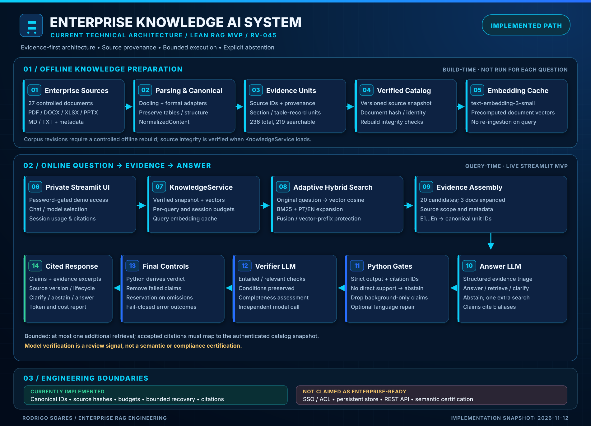
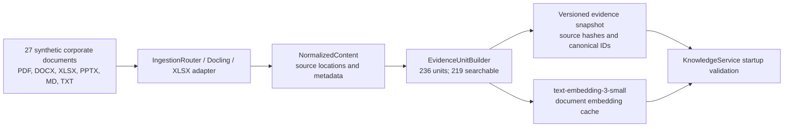

# Current Lean MVP Architecture — Technical Specification

**System:** Enterprise Knowledge AI System  
**Architectural snapshot:** 12 November 2026  
**Target branch:** `claude/lean-mvp-hardening`  
**Status:** Functional, privately accessible **lean RAG MVP** (RV-045); **not** certified for production or semantic correctness  
**Canonical runtime:** `app/frontend/main.py` → `app/service/knowledge_service.py` → `app/orchestration/lean_pipeline.py`  
**Purpose:** Describe the *implemented* runtime and its contracts. Historical experiments are cited but explicitly excluded from this execution path.

> Evidence before generation. Every material claim must refer to a canonical source; a valid citation ID does not itself prove semantic entailment.

## 1. Scope and architectural decision

This specification supersedes the older RV-016 runtime diagram **for the active Streamlit MVP only**. It does not delete or redefine experimental Stage-1, v3, v4.2 or Evidence Assurance work. Those branches of investigation remain in the repository for audits and possible future qualification.

The active MVP deliberately chooses **bounded retrieve → answer → verify**, rather than an unrestricted multi-stage autonomous orchestrator. The runtime distinguishes a reproducible *offline catalog build* from per-question *online inference*. Offline source versions, the evidence catalog and precomputed document embeddings are validated before the model answers a question.



**Editable diagram:** [SVG](../images/architecture-overview.svg) · [HTML preview](../images/architecture-overview.html).

## 2. System boundaries

| Boundary | Implemented component | Input → output | Guarantee / non-guarantee |
|---|---|---|---|
| Sources | `data/source/corporate_repository`, registry / audit tools | Physical docs and metadata → controlled source set | Synthetic corpus; not live enterprise connectors |
| Parsing | `app/ingestion/ingestion_router.py`, Docling, native XLSX adapter | PDF/DOCX/XLSX/PPTX/MD/TXT → normalized content | Structural representation; parse quality must still be tested |
| Canonical model | `app/ingestion/schemas.py` | Parser output → `NormalizedContent` | Owns representation independently of parser internals |
| Evidence units | `app/chunking/evidence_units.py` | Canonical blocks → citable `EvidenceUnit` | Provenance/source identity; slide-level units still limited |
| Snapshot | `app/chunking/evidence_snapshot.py` | Sources + units → `EVIDENCE_UNITS_SNAPSHOT_27DOC.json` | Validates structural re-materialization and file hashes; not a digital signature |
| Embeddings | `app/retrieval/openai_embeddings.py`, evidence cache | Search text → `text-embedding-3-small` vectors | Cached physical corpus vectors; costs checked separately |
| Application | `app/frontend/main.py`, `app/frontend/access.py` | Authenticated chat → request/session view | Shared-password private demo, not SSO or per-user authorization |
| Service | `app/service/knowledge_service.py` | Question + selected model → answer with sources and usage | Loads and validates snapshot/cache once per session; enforces session budget |
| Retrieval | `app/retrieval/adaptive_evidence_retriever.py` | Query + optional DOC scope → ranked evidence units | Vector cosine + BM25 PT/EN expansion + adaptive fusion; not semantic completeness |
| Context | `app/orchestration/lean_pipeline.py` | Ranked units → expanded ordered evidence with E aliases | Bounded, canonical IDs; no guarantee the decisive rule is included |
| Answer | `app/orchestration/lean_live_provider.py` | Question + evidence → structured model decision | May answer, ask to retrieve, clarify or abstain; model judgments need review |
| Validation | `app/orchestration/lean_pipeline.py` | Decision → checked claims, possible verification | Python enforces schema/IDs/scope and no-direct-evidence rule |
| Verification | `app/orchestration/lean_live_provider.py` | Proposed cited claims + scoped sources → independent model review | Entailment/relevance/conditions/completeness are **model assessments**, not proven semantic truth |
| Rendering | `KnowledgeService._answer` + Streamlit UI | Accepted claims → citations, source excerpts, reservations, usage | Does not perform workflow approval or enterprise governance |
| Evaluation | `app/evaluation/answer_criteria.py`, RV-045 results | Stored answer → deterministic case score | Regex/facts/source match; no full human semantic certification |
| Deployment / CI | `render.yaml`, `.github/workflows/ci.yml` | Private demo blueprint / offline checks | Manual deployment; no claim of public enterprise deployment |

## 3. Offline preparation pipeline



The MVP catalog described by RV-045 contains **27 physical documents, 236 evidence units and 219 searchable units**. It is derived from the *cleaned* corpus; RV-035/RV-036 metrics belong to an earlier corpus snapshot and should not be attributed to the cleaned runtime. `verify_snapshot` reconstructs the units and checks source/input integrity on load; embeddings are checked against the same unit identities.

**Lifecycle:** rebuild the canonical snapshot and vector cache when sources are intentionally changed. The standard per-question request **does not** reparse all documents or regenerate document vectors.

## 4. Online runtime sequence

```mermaid
sequenceDiagram
  actor User
  participant UI as Streamlit
  participant S as KnowledgeService
  participant R as Adaptive Retriever
  participant P as run_lean (Python)
  participant L as Answer LLM
  participant V as Verifier LLM
  User->>UI: Question + selected model
  UI->>UI: Shared demo password (before use)
  UI->>S: ask(question, model)
  S->>S: Session budget + verified catalog
  S->>P: run_lean(..., top_k=20, expand_documents=3)
  P->>R: search(question, DOC scope, top_k)
  R-->>P: Vector/BM25 fused canonical units
  P->>P: Expand selected documents, assign E aliases
  P->>L: Structured decision + cited claims
  alt Missing recoverable evidence
    L-->>P: retrieve + recovery_query
    P->>R: ONE additional bounded search
    R-->>P: New canonical units
    P->>L: Final structured decision
  else Clarify or abstain
    L-->>P: clarify / abstain
  end
  opt Answer with supported candidate claims
    P->>P: Validate schema, aliases, scope, evidence labels
    P->>V: Verify cited claims against selected evidence
    V-->>P: Per-claim checks + completeness assessment
    P->>P: Derive verdict; drop failed claims; flag omissions
  end
  P-->>S: Answer / reservations / abstention / error + trace
  S-->>UI: Claims, sources, usage, cost
  UI-->>User: Render cited response or controlled outcome
```

**Operational specifics:** the original question is embedded and ranked against precomputed document vectors; the adaptive retriever also runs BM25 after controlled lexical expansion. `run_lean` accepts only returned canonical, ready and searchable units and enforces an explicit `DOC-NNN` restriction when the question names one or more documents. The selected best three documents are expanded in source order, within a bounded maximum of 60 evidence units.

The answer model classifies evidence as `direct`, `conditional`, `background` or `irrelevant`, then chooses `answer`, `retrieve`, `clarify` or `abstain`. Only **one** additional retrieval attempt is allowed. Python validates output shape, citation aliases and direct-evidence conditions before a second model call evaluates the claims. A language-repair call is bounded to one attempt when applicable.

## 5. Contracts and invariants

| Contract | Enforced behavior | Remaining limitation |
|---|---|---|
| Source membership | Retrieved unit ID must exist in the loaded canonical catalog and match the exact unit object | Does not represent tenant-based ACL |
| Document scope | Explicit `DOC-NNN` identifiers constrain both initial and recovery search | Natural-language authority/application rules are not independently enforced |
| Citation aliases | `E1…En` map to canonical unit IDs for the selected evidence set | Referential integrity is not semantic entailment |
| Bounded retrieval | `top_k = 20`; expanded context max 60 units; at most one additional search | More retrieved text may increase distraction |
| Answer schema | Strict JSON and expected fields; uncited or unusable claims are dropped | Model can still misinterpret a cited sentence |
| Evidence triage | No model-labeled direct passage → abstain; background-only claims removed | Triage label itself is a model judgment |
| Review | Separate LLM checks entailment, relevance and conditional preservation; Python computes accepted claim set | No independent semantic ground truth at runtime |
| Completeness | On incomplete review, default behavior flags an explicit reservation | A partial but valid response may remain incomplete |
| Budget | Shared `BudgetedClient`, per-question and session spend ceilings | Configured estimates must match current provider billing |
| Access | Demo password must be configured before invoking the service | Not SSO, roles, audit-grade user identity or document ACL |

The active configuration in `config/lean_runtime.json` sets a maximum *estimated* cost of **USD 0.30 per question** and **USD 0.50 per session**, `deadline_seconds = 120`, `max_output_tokens_per_call = 4500`, and the snapshot/model choices. These are runtime configuration values, not guarantees of fixed provider pricing or latency.

## 6. Outcome state machine

| Outcome | Meaning | Presentation |
|---|---|---|
| `answered_pending_human_review` | Accepted cited claims; verifier checks passed | Cited answer with human-review caveat |
| `answered_with_reservations` | Surviving claims with an omission/claim-removal reservation | Answer plus explicit reservations |
| `clarification_required` | Context needs clarification | No fabricated final answer |
| `abstained` | Requested document or direct evidence is unavailable / insufficient | Explicit abstention |
| `review_rejected` | All candidate claims rejected or withheld | No unverified answer |
| `budget_exceeded` | Request budget ceiling reached | Controlled error, no over-budget continuation |
| `execution_failed` | Exception or contract/provider failure | Controlled failure, not an evidence claim |

The phrase "verified answer" in the UI indicates a **model-mediated review**, not an independently certified factual conclusion.

## 7. Evaluation evidence and boundaries

RV-045 evaluates the clean 27-document corpus with `gpt-6.1-sol`: **45/46 deterministic criteria passes, one run per case** (Q20 failed to cite one additional applicable policy). Its scoring measures required documents/facts and disallowed patterns, **not** universal semantic correctness. A separate semantic audit cited in the README reports **40/46 under strict review**; see the corresponding saved experiment before repeating or extrapolating that number.

The CI workflow runs offline unit/integration tests, frontend/manifest checks, corpus leakage checks and validation of the **archived** RV-045 report. It does not replay 46 paid model calls on each push. Historical `ask_knowledge`, `RagService`, Stage-1 planning, v3/v4.2 orchestration, and proposed Evidence Assurance must not be silently described as steps of the live Streamlit execution.

## 8. Open risks and next engineering work

1. **Q20 multi-policy completeness:** answers can omit a related governing document even when citations are structurally valid.
2. **Human semantic audit:** review a representative sample for entailment, applicability, negation/conditions, citations and completeness.
3. **Document authority and access:** policy status appears as metadata/model context; there is no production-grade tenant/document authorization enforcement.
4. **PPTX evidence granularity:** slide-level citation accuracy remains a known engineering issue.
5. **Private demo hardening:** SSO, per-user quotas, persistent evidence store, audit logs, REST API and operational observability are not implemented.

### Source-of-truth links

- [RV-045 — cleaned corpus and MVP evaluation](20_rv045_clean_corpus_and_mvp_interface.md)
- [RV-044 — lean pipeline v2 and criteria](19_rv044_lean_v2_and_answer_criteria.md)
- [RV-043 — original lean candidate rationale](18_rv043_lean_evidence_pipeline.md)
- [RV-016 — historical architecture snapshot](03_current_architecture_and_contracts.md)
- [README](../../README.md)
- [Editable architecture diagram](../images/architecture-overview.svg)

**Change discipline:** future architecture diagrams should be updated from inspected implementation and runtime config first, then made stylistically consistent with the existing navy/cyan project identity. Label measured outcomes, experimental paths and proposals separately.
